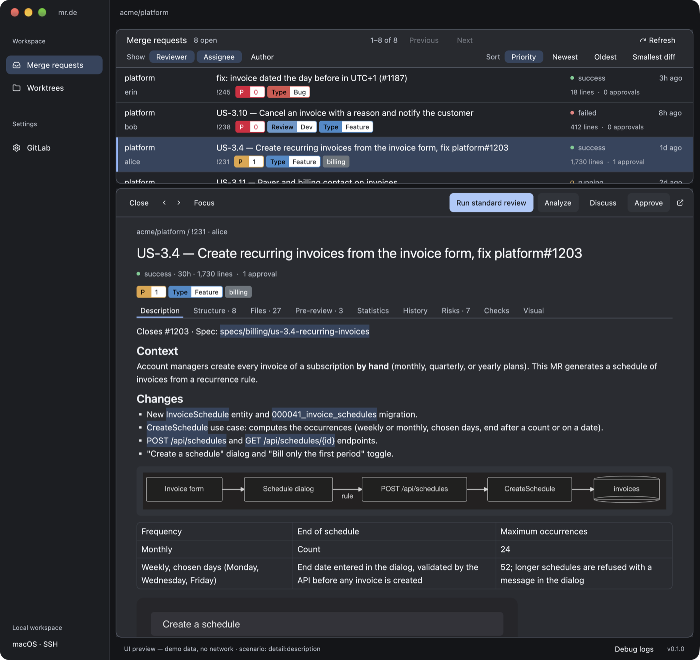
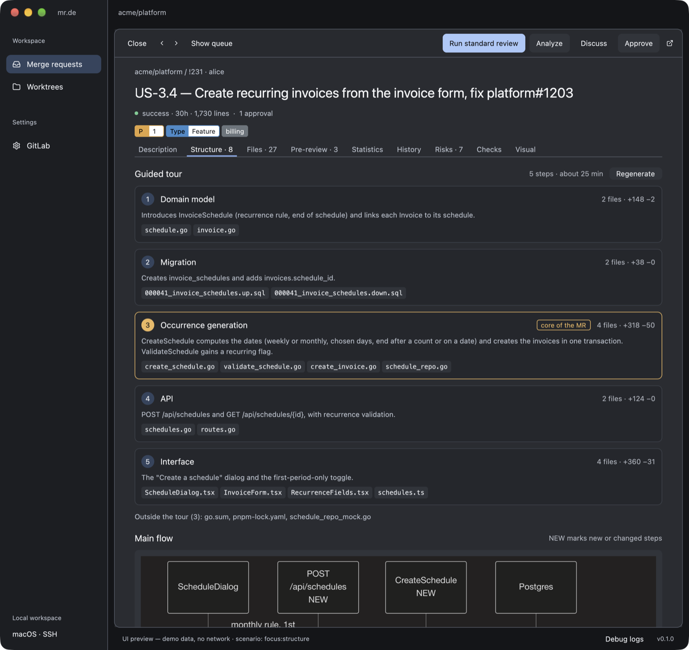
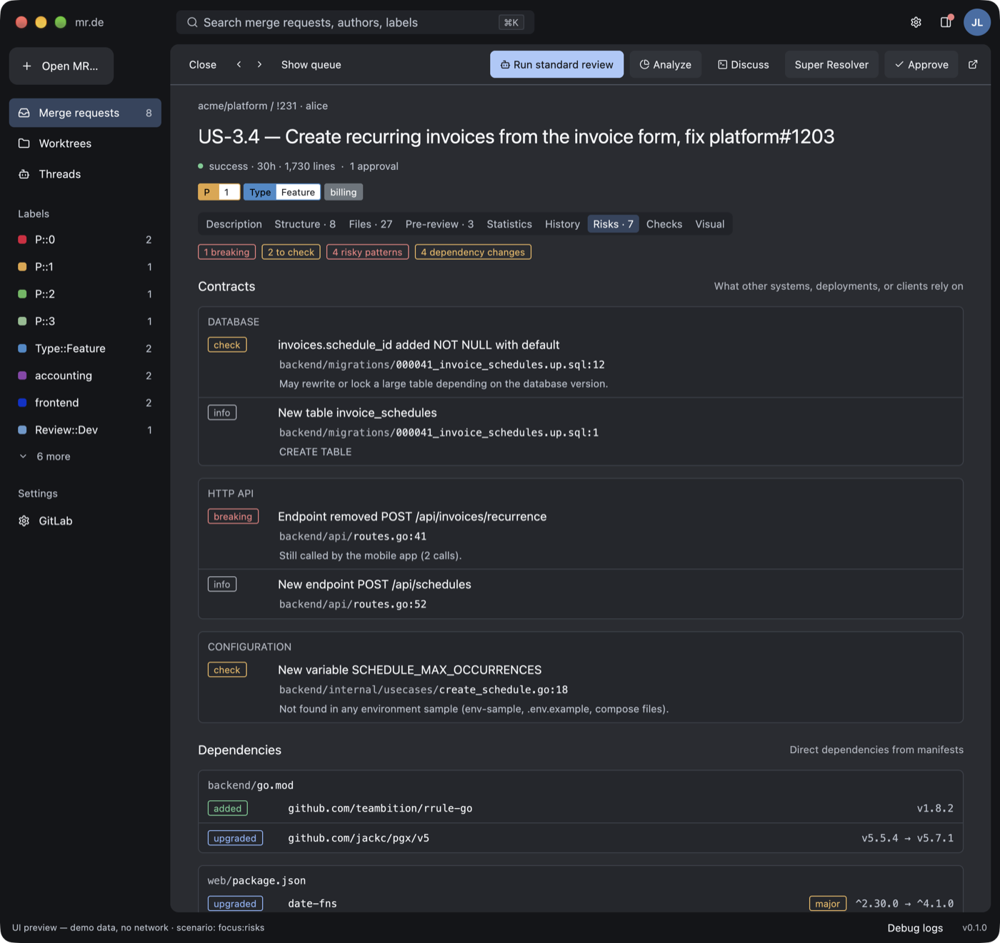
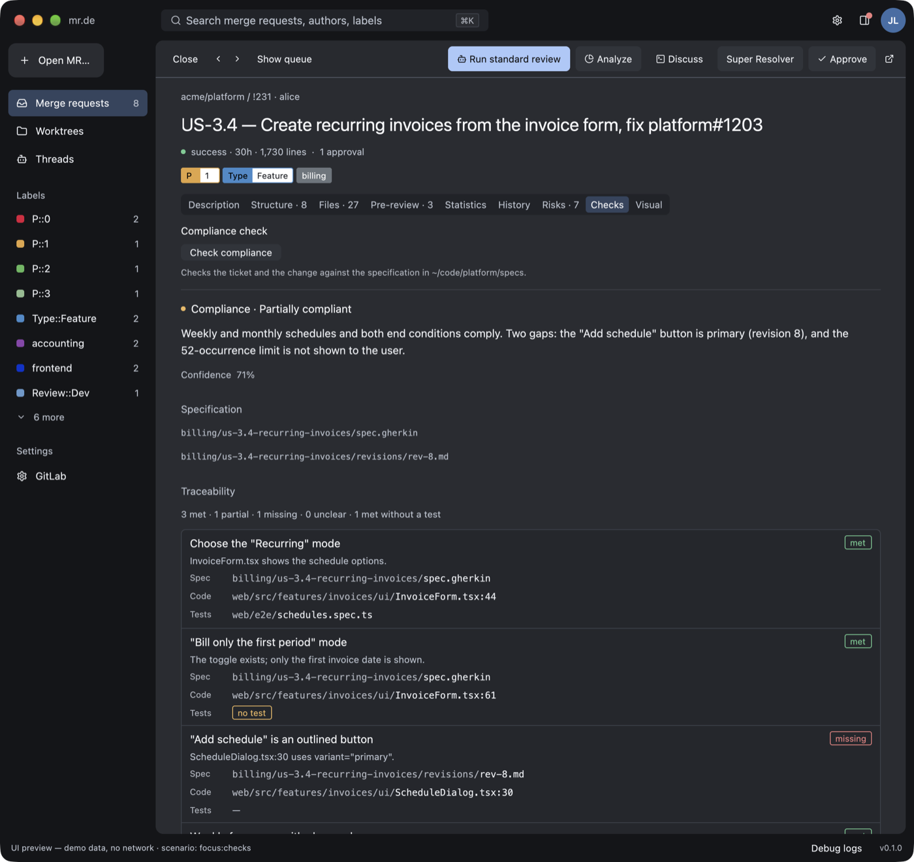

# mr.de

A native macOS review cockpit for GitLab merge requests and GitHub pull requests, built in Rust with
[GPUI](https://github.com/zed-industries/zed/tree/main/crates/gpui). It gathers your review queue, merge request descriptions,
linked tickets, changed files, and approval in one window, and helps you understand large
merge requests before approving them: structure, history, contracts, risks, traceability to
a specification, and before/after screenshots.

AI assistance uses your local [Claude Code](https://github.com/anthropics/claude-code)
CLI and runs only when you click a button. There is no Anthropic API key and no background
analysis.

> **Status: experimental.** mr.de is an early personal project, published mainly for
> archiving and reference. It works against real GitLab instances, but expect rough edges,
> breaking changes, and missing packaging. macOS only.



## Features

- **Review queue.** Open merge requests where you are reviewer, assignee, or author, across
  projects, with explicit Draft badges. Sort by priority labels (`P0`, `P::1`, …), pipeline
  state, age and size, or by date, diff size, approval count or risk. Labels come with their GitLab colors, including those of
  the linked ticket when teams label tickets rather than merge requests. Search the queue
  (**⌘K**), filter it by labels from the sidebar, or open any merge request from its link.
- **Changes and risk radar.** Eight configurable, explainable risk axes with the review depth
  they call for, a per-axis team median, cached queue miniatures and risk sorting. Each axis
  shows its evidence; each changed file its findings, line owners and history. Axis
  discussions start Claude only on click.
- **Review context panel.** Pre-review risks, compliance, analysis findings, the ticket, and
  approvals beside the reader; collapsible to a rail of counters (**⌘⌥B**).
- **Reader.** Markdown descriptions with tables, images from GitLab uploads, and Mermaid
  diagrams rendered in pure Rust. Linked issues, changed files with line counts, and a
  *Disktree* treemap of the most changed areas.
- **Pre-review with Claude** at three depths (Quick, Standard, Deep): summary, intention,
  severity-ranked risks, priority files, and confidence. Results are cached per commit.
- **Understand complex merge requests** (local Git analysis, no AI):
  - *Structure*: changed functions and types with signature changes, callers the MR did not
    update, and a graph of how the changed files depend on each other. Claude can add a
    guided reading tour with a flow diagram.
  - *History*: why removed code existed (`git blame` back to the commit and ticket), risky
    files with frequent fixes, who knows each area (including `CODEOWNERS`), and other merge
    requests touching the same files.
  - *Risks*: contract changes (database migrations, HTTP endpoints, API schemas, environment
    variables, permissions), dependency upgrades, and risky patterns in added lines.
- **Specification compliance.** Claude reads a folder of specifications and builds a
  traceability matrix: requirement, code, tests, status.
- **Visual comparison.** Your own screenshot command (for example Playwright) runs on the
  base and merge request commits; mr.de shows before, after, and a pixel difference.
- **Super Resolver and Threads.** Rebase, repair conflicts, inspect failed CI jobs, and push
  corrections from an isolated worktree. Stop after three repair attempts or a question;
  take over the saved Claude session in an embedded Ghostty terminal, then resume.
- **Safe approval.** Approval requires confirmation and is bound to the reviewed commit SHA.
  mr.de never merges.
- **Ask Claude** opens Claude Code, read-only, in an embedded terminal on the merge
  request's worktree, with the context prepared for you. Sessions are kept in **Threads**.

| Structure | Risks | Traceability |
|---|---|---|
|  |  |  |

All screenshots use the built-in demo data (`--ui-preview`).

## Requirements

- macOS with Xcode and its command-line tools (the macOS SDK is required).
- Rust 1.97.1; the toolchain is pinned in `rust-toolchain.toml`.
- Zig 0.16.0 for the embedded Ghostty build. The bootstrap script needs Python 3.12+ and
  installs a checksum-verified copy under `target/tools/`, without replacing system Zig.
- Git with SSH access to your GitLab or GitHub repositories. Your `~/.ssh/config`, including
  any `ProxyCommand`, is used as is.
- A GitLab personal access token with the `api` scope (self-hosted instances behind
  Cloudflare Access are supported with a service token), or a GitHub token with the `repo`
  scope or the equivalent fine-grained permissions (see the user guide).
- Optional: Claude Code installed and logged in, for pre-reviews, tours, compliance, and Super Resolver.

## Quick start

```sh
git clone git@github.com:kwop/mr.de.git
cd mr.de
python3 scripts/bootstrap-ghostty.py          # skip if Zig 0.16.0 is already available
cargo run --locked -p mrde -- --ui-preview   # explore with demo data, no network
cargo run --locked -p mrde                   # connect to your GitLab instance
```

On first launch, open **Project settings**, name your project, choose GitLab or GitHub, enter its URL and token,
then **Test connection** and **Save**. The project selector above the sidebar menus lets you
switch workspaces or create another with **New project**. Each has its own connection, optional
GitLab group or GitHub owner, preferences, credentials, and cached data.

Secrets stay in macOS Keychain. Other settings live in `~/.config/mrde/projects.toml`
(see [`config/projects.example.toml`](config/projects.example.toml)). Existing `config.toml`
connections are imported automatically without changing their credentials; the original file
is retained. See [Projects and configuration](docs/user-guide.md#configuration).

To build an optimized binary:

```sh
cargo build --locked --release -p mrde
cargo install --locked --path crates/mrde-app   # installs `mrde` in ~/.cargo/bin
```

For a signed `.app` with Touch ID support, see [macOS signing and Touch ID](docs/touch-id.md).

## Risk configuration

Copy [`config/risk.example.toml`](config/risk.example.toml) to `~/.config/mrde/risk.toml`.
Override it per profile in `~/.config/mrde/projects/<id>/risk.toml` and per repository in
`risk.toml`. The example documents all normalization curves, sensitive globs and weights,
coverage, lint commands, debt regexes, baseline size and verdict thresholds. Repository
commands need explicit approval. Missing tools or historical commits stay unavailable.
See [the risk guide](docs/risk.md) for measurement limits, sample counts and cache behavior.

## Security and privacy

- Tokens live only in the macOS Keychain, never in files, the cache, URLs, or logs.
- GitLab is accessed over HTTPS; redirects are refused so credentials cannot leak to another
  host.
- Claude, analyses, screenshots, and approvals run only on explicit clicks. Merge request
  text reaches Claude on standard input, never in command-line arguments. Reviews use
  read-only tools; Super Resolver also allows file edits. MR.DE manages commits and source
  branch pushes with an explicit `--force-with-lease` for the last observed SHA.
- The local cache (`~/Library/Caches/mrde/`) contains merge request descriptions and AI
  summaries, resolver sessions, and bounded job traces from your instance. Credentials are
  never attached to Claude prompts or stored in this cache.

## Standalone radar and Claude Code plugin

Use the same risk engine from a terminal or a Claude Code session, without launching GPUI:

```sh
cargo install --locked --path crates/mrde-radar
mrde-radar --base origin/main --worktree --json
```

The CLI supports current files or two commits, text/JSON/SVG output, and explicit external
checks. The [Claude plugin](plugins/mrde/README.md) adds `/mrde:radar` to the current session.
See the [CLI guide](docs/radar-cli.md) for configuration, installation and limitations.

## Documentation

- [Product specifications](specs/README.md): Gherkin contracts and automation entry points.
- [UI reference and native story catalog](specs/ui/README.md): design conventions, interactive previews and review captures.
- [User guide](docs/user-guide.md): configuration, review workflow, labels, analysis tabs,
  compliance, visual comparison, and worktrees.
- [Architecture](docs/architecture.md): crates, data flow, caching, and how Claude and Git
  are invoked.
- [Development](docs/development.md): building, testing, the UI preview and screenshot
  harness, and GPUI layout pitfalls.
- [Known limitations](docs/limitations.md).

## License

MIT, see [LICENSE](LICENSE). The vendored copy of `gpui-component` in
[`vendor/gpui-component`](vendor/gpui-component) keeps its Apache-2.0 license; its small
local patches are listed in [`MRDE-PATCH.txt`](vendor/gpui-component/MRDE-PATCH.txt).

The small [`mrde-ghostty-adapter`](vendor/mrde-ghostty-adapter) keeps its upstream MIT
license and adapts `gpui-libghostty` 0.3.1 to GPUI 0.2.2.
