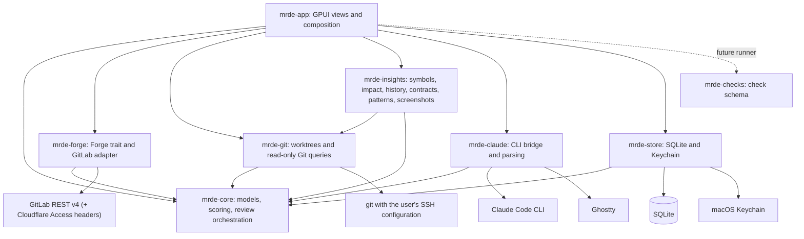

# Architecture

mr.de is a Cargo workspace. The application crate is named `mrde` (package, library, and
binary); the other crates hold domain logic and adapters, independent of the UI.

| Crate | Role |
|---|---|
| `crates/mrde-app` | GPUI views, theme, settings, application composition, UI preview and screenshot harness. |
| `crates/mrde-core` | Serializable domain models, queue scoring, review orchestration ports, analysis result models. |
| `crates/mrde-forge` | `Forge` trait and the GitLab REST API v4 adapter. |
| `crates/mrde-git` | Dedicated bare repositories, detached worktrees, and read-only Git queries using the system `git`. |
| `crates/mrde-insights` | Worktree analysis (symbols, impact, file graph, history, contracts, dependencies, patterns) and screenshot comparison. |
| `crates/mrde-claude` | Claude Code CLI bridge with strict response parsing, prompts, and the Ghostty launcher. |
| `crates/mrde-store` | Versioned SQLite cache and macOS Keychain access. |
| `crates/mrde-checks` | Check definitions, merge rules, and result schema; no runner yet. |



## Runtime model

The GPUI view (`Cockpit`) owns the UI state. Network and subprocess work runs on a Tokio
runtime through an injected `Executor`; results come back to the UI through a channel polled
every 150 ms. Tests and the preview replace the executor, so no test touches GitLab, Git,
Claude, or the Keychain.

The periodic queue refresh never locks navigation, pagination, or settings. Explicit
operations (testing or saving settings, opening a merge request, changing filters) take
priority: they cancel a pending refresh and discard its late response. Refresh, detail
loading, reviews, and analyses can be cancelled; approvals and credential saves cannot be
interrupted midway.

`mrde-core::review::ReviewServices` keeps review orchestration independent of concrete
adapters; the `Forge` trait stays in `mrde-forge` and the application composes both.


## GitLab adapter

- Queue: `GET /merge_requests` per role with `with_labels_details=true`, paginated, drafts
  excluded.
- Enrichment, four merge requests at a time: the merge request, its approvals, and its
  related issues, fetched concurrently. A new commit also loads its diffs once to count
  changed lines; afterwards an unchanged commit reuses the cached count.
- Labels: the single-MR and related-issue endpoints return names only, so names are colored
  from `GET /projects/:id/labels?include_ancestor_groups=true`, cached for ten minutes per
  project. Ticket labels come from the primary ticket (see the user guide).
- Overlapping merge requests: the 30 most recently updated open merge requests and those
  merged in the last 14 days, intersected by file path through `/diffs`.
- Images: uploads go through the authenticated project uploads API; credentials are never
  sent to other hosts, and redirects are refused.

## Caching

Results are keyed by instance, merge request, source and base SHA, description, linked
issues, prompt version, and (for reviews) depth. Results apply only to the commit they were
computed for. The SQLite cache stores the queue, reviews, analyses, tours, screenshot
reports, and an action history; it never stores secrets.

## Analysis (`mrde-insights`)

`analyze()` gathers its input with read-only Git commands on validated SHAs (`git diff -U0`,
`git show`, `git blame --porcelain`, `git log`, `git grep`, `git ls-tree`) and passes it to
pure functions, each with its own tests:

| Module | Purpose |
|---|---|
| `diff` | Parses zero-context unified diffs, including renames, binaries, and deletions. |
| `lang` | Language, test, and generated-file detection from paths. |
| `symbols` | Definitions per language with line patterns and brace or indentation matching; compares base and head. |
| `imports` | Import resolution (relative and `@/` TypeScript, Go modules, Rust `crate::`/`mod`, Python) and HTTP links to declared routes. |
| `contracts` | Migrations, endpoints, API schemas, environment variables, permissions. |
| `deps` | Manifest comparison with semver-aware major detection; lockfile counts. |
| `patterns` | Risky patterns on added lines, with loop detection. |
| `history` | Risk from churn and fix commits, experts per area, `CODEOWNERS`, blame origin. |
| `visual` | Runs the screenshot command and compares PNG files pixel by pixel. |

## Claude integration

Claude Code runs as `claude -p <fixed prompt> --output-format json` with only the `Read`,
`Glob`, and `Grep` tools, in the merge request worktree. Merge request text, issues, and
diffs are sent on standard input, labelled as untrusted data, and never appear in process
arguments. Responses (CLI envelope, structured output, or fenced JSON) are parsed strictly
and validated. Prompts live in `crates/mrde-claude/prompts/`.

## Planned: checks

Check definitions are parsed but not executed yet. Global checks belong in
`~/.config/mrde/checks.toml` and repository checks in `.mrde.toml` (see
[`examples/.mrde.toml`](../examples/.mrde.toml)). Definitions merge by `id`; repository
definitions override global ones but are always marked `proposed`, even if their TOML claims
approval, so a repository cannot approve its own commands.

```toml
[[checks]]
id = "rust-tests"
command = ["cargo", "test", "--workspace"]
approval = "proposed"
```

Results will use this shape, with statuses `passed`, `failed`, `skipped`, or `error`:

```json
{"id": "rust-tests", "status": "passed", "duration_ms": 1234, "artifacts": [], "details": {"exit_code": 0}}
```
