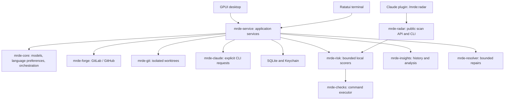
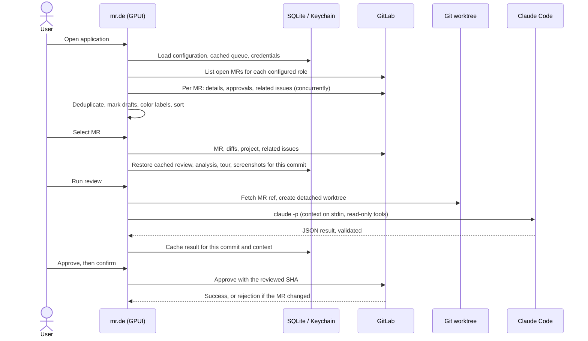
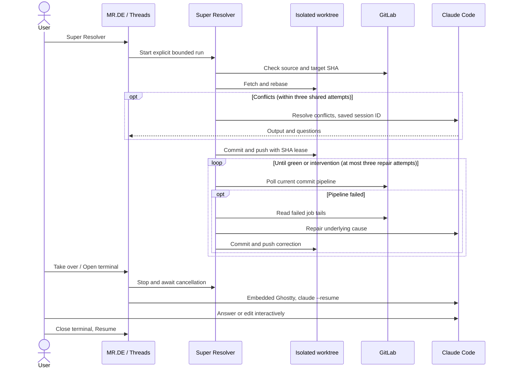

# Architecture

mr.de is a Cargo workspace. The application crate is named `mrde` (package, library, and
binary); the other crates hold domain logic and adapters, independent of the UI.

| Crate | Role |
|---|---|
| `crates/mrde-radar` | Public headless scan service and text/JSON/SVG CLI, sharing `mrde-risk`; see [CLI architecture](radar-cli.md). |
| `crates/mrde-app` | GPUI presentation, native terminal integration and screenshot harness. |
| `crates/mrde-tui` | Ratatui presentation, input/effect state, async worker adapter and deterministic buffer exports. |
| `crates/mrde-service` | Frontend-independent executors, project catalog, connection/language settings, shared cache orchestration and demo fixtures. |
| `crates/mrde-core` | Serializable domain models, queue scoring, review orchestration ports, analysis result models. |
| `crates/mrde-forge` | `Forge` trait and GitLab REST / GitHub REST and GraphQL adapters. |
| `crates/mrde-git` | Dedicated bare repositories, detached worktrees, and read-only Git queries using the system `git`. |
| `crates/mrde-insights` | Worktree analysis (symbols, impact, file graph, history, contracts, dependencies, patterns) and screenshot comparison. |
| `crates/mrde-claude` | Claude Code CLI bridge with strict response parsing, prompts, and the questions context. |
| `crates/mrde-store` | Versioned SQLite cache and macOS Keychain access. |
| `crates/mrde-resolver` | Bounded repair state machine, injected effects, durable session updates. |
| `crates/mrde-checks` | Check definitions, merge rules, result schema, bounded subprocess runner. |
| `crates/mrde-risk` | Local risk scorers, report parsing, layered configuration and per-axis timeouts. |



## Project boundaries

`Config` carries a stable project ID, display name, `Provider`, URL, and optional group.
`mrde-service::projects` loads a versioned `projects.toml`, importing the former single connection
when needed. Saves use a serialized read-modify-write and atomic rename, so saving preferences
for an older project cannot replace the active project. Unknown fields and duplicate IDs fail
validation; secrets never enter this model.

The project ID, provider, and URL namespace credentials. The cache namespace also includes the
group. The reserved imported `default` project retains the old URL identity for compatibility.
Forge clients, SQLite keys, worktrees, reviews, and Threads use these boundaries. The GitLab
adapter uses the [group merge request endpoint](https://docs.gitlab.com/api/merge_requests/#list-group-merge-requests)
when scoped; the GitHub adapter adds an `org:`, `user:`, or `repo:` search qualifier.

Project switching runs off the GPUI thread, rejects old action generations, clears selected
content and image assets, and rebinds the image client. In-flight review operations retain
captured configurations; each project's Threads entity retains its jobs and hides its native
terminal while inactive. Saving edited credentials resets that project's running Threads.

## Runtime model

The GPUI view (`Cockpit`) owns the UI state. Network and subprocess work runs on a Tokio
runtime through an injected `Executor`; results come back to the UI through a channel polled
every 150 ms. Tests and the preview replace the executor, so no test touches GitLab, Git,
Claude, or the Keychain through the UI executor. Git adapter tests use temporary local repositories.

Navigation has an independent, cancellable loading task: opening another MR or Worktrees
never waits for a review, analysis, connection test, or save. Only conflicting operations
are disabled. Operation results are bound to their MR and commit; late navigation and
old-configuration responses are discarded. Save completion does not change the current page.
A pending queue refresh yields to explicit operations. Approvals and credential saves cannot
be interrupted midway.

Configuration/cache loading and sorting run outside GPUI. Markdown preparation, initial
parsing, Mermaid layout, diff statistics, and treemaps use background tasks with loading
states. Large Markdown documents use a bounded virtualized viewport; the Files tab renders
only visible rows and uses an indexed statistics lookup.

`mrde-core::review::ReviewServices` keeps review orchestration independent of concrete
adapters; the `Forge` trait stays in `mrde-forge` and `mrde-service` composes both. The two frontends inject the same executor and settings ports.



## GitLab adapter

- Queue: `GET /merge_requests` per role with `with_labels_details=true`, paginated, preserving draft status. The first refresh also reads `GET /user` for the title bar.
- Opening a link: the path is checked against the configured instance first, then
  `GET /projects/:path` gives the project id for the usual merge request requests.
- Enrichment, four merge requests at a time: the merge request, its approvals, and its
  related issues, fetched concurrently. A new commit also loads its diffs once to count
  changed lines; afterwards an unchanged commit reuses the cached count.
- Labels: the single-MR and related-issue endpoints return names only, so names are colored
  from `GET /projects/:id/labels?include_ancestor_groups=true`, cached for ten minutes per
  project. Ticket labels come from the primary ticket (see the user guide).
- Overlapping merge requests: the 30 most recently updated open merge requests and those
  merged in the last 14 days, intersected by file path through `/diffs`.
- Images: uploads go through the authenticated project uploads API; credentials are never
  sent to other hosts, and redirects are refused.

## GitHub adapter

`mrde-forge::github` implements the same `Forge` trait. Repositories are addressed by numeric
ID (`/repositories/{id}`), so `MrId.project` stays numeric and renamed repositories keep
working.

- Queue: a GraphQL `search` per role filter (`review-requested`, `reviewed-by`, `assignee`,
  `author`, plus the scope qualifier), including draft status, returning labels with colors,
  `latestOpinionatedReviews`, `statusCheckRollup`, sizes, and head and base commits. Results
  are kept for 60 seconds so the enrichment that follows each refresh costs no request;
  queue entries that already carry a size never download diffs.
- Detail: the pull request with `closingIssuesReferences` (GraphQL), its files
  (`/pulls/{n}/files`, up to 3,000), and the merge base (`/compare/{base}...{head}`).
- Approval: `GET /pulls/{n}` checks that the head is still the reviewed commit, then
  `POST /pulls/{n}/reviews` with `event=APPROVE` and that `commit_id`.
- Overlaps and merged history: `GET /pulls` (open, and closed within 14 days) and their files.
- Requests carry `Authorization: Bearer`, `X-GitHub-Api-Version`, and a `User-Agent`; redirects
  are refused, and rate-limit exhaustion is reported as such.

## Caching

Results are keyed by instance, merge request, source and base SHA, description, linked
issues, prompt version, and (for reviews) depth. Results apply only to the commit they were
computed for. The SQLite cache stores the queue, reviews, analyses, tours, screenshot
reports, resolver threads/sessions, and an action history; it never stores secrets.

## Analysis (`mrde-insights`)

`analyze()` gathers its input with read-only Git commands on validated SHAs (`git diff -U0`,
`git show`, `git blame --porcelain`, `git log`, `git grep`, `git ls-tree`) and passes it to
pure functions, each with its own tests:

| Module | Purpose |
|---|---|
| `diff` | Parses zero-context unified diffs, including renames, binaries, and deletions. |
| `lang` | Language, test, and generated-file detection from paths. |
| `symbols` | Definitions per language with line patterns and brace or indentation matching; compares base and head. |
| `imports` | Import resolution (relative and `@/` TypeScript, Go modules, Rust `crate::`/`mod`, Python) and HTTP links to declared routes. |
| `contracts` | Migrations, endpoints, API schemas, environment variables, permissions. |
| `deps` | Manifest comparison with semver-aware major detection; lockfile counts. |
| `patterns` | Risky patterns on added lines, with loop detection. |
| `history` | Risk from churn and fix commits, experts per area, `CODEOWNERS`, blame origin. |
| `visual` | Runs the screenshot command and compares PNG files pixel by pixel. |

## Claude integration

Claude Code runs as `claude -p <fixed prompt> --output-format json` with only the `Read`,
`Glob`, and `Grep` tools, in the merge request worktree. Merge request text, issues, and
diffs are sent on standard input, labelled as untrusted data, and never appear in process
arguments. Responses (CLI envelope, structured output, or fenced JSON) are parsed strictly
and validated. Prompts live in `crates/mrde-claude/prompts/`.

Threads have a kind (`ThreadKind` in `mrde-core::resolver`): **Resolver** runs the Super
Resolver loop below, **Questions** only opens Claude Code. **Ask Claude** prepares the review
worktree and the context file (`Action::Ask`), then the questions thread starts the embedded
terminal with `claude --session-id <id> --permission-mode plan --add-dir <context dir>` and
the first message; later openings use `claude --resume <id> --permission-mode plan` in the
same worktree, which Claude Code needs to find the session. Questions threads have no
automation, so Stop and Resume do not apply to them.

## Planned: checks

Check definitions are parsed but not executed yet. Global checks belong in
`~/.config/mrde/checks.toml` and repository checks in `.mrde.toml` (see
[`examples/.mrde.toml`](../examples/.mrde.toml)). Definitions merge by `id`; repository
definitions override global ones but are always marked `proposed`, even if their TOML claims
approval, so a repository cannot approve its own commands.

```toml
[[checks]]
id = "rust-tests"
command = ["cargo", "test", "--workspace"]
approval = "proposed"
```

Results will use this shape, with statuses `passed`, `failed`, `skipped`, or `error`:

```json
{"id": "rust-tests", "status": "passed", "duration_ms": 1234, "artifacts": [], "details": {"exit_code": 0}}
```

## Super Resolver

`mrde-resolver::Services` injects GitLab, worktrees, Claude, persistence, and polling waits.
Each run has at most three repair attempts, shared by conflict resolution and CI fixes.
Only a successful pipeline for the published SHA is accepted; source and target are checked
again before reporting success. Absent pipelines stop after five minutes; running pipelines
stop after an hour. Manual/canceled/skipped pipelines require intervention.

Resolver worktrees use their own bare repository per thread and fetch the source project's
branch, including forks, plus the target project's branch. Rebase conflicts stay on disk.
Only the source ref is pushed, with an explicit SHA lease. No merge or approval occurs.

Each repair receives a persisted UUID with `claude --session-id`, `stream-json`, and a
strict result schema. Tools are limited to Read/Glob/Grep/Edit/Write; the runner owns Git
commands. Context and bounded failed-job tails go over stdin. Responses and tool events
appear incrementally in Threads. SQLite migration 002 stores thread snapshots; generation
and sequence numbers reject late writes after Stop or Resume. Relaunch never restarts work.

Interactive takeover waits for cancellation of the headless worker before invoking
`claude --resume` in the same directory. Native libghostty surfaces handle the PTY, Metal
rendering, input, selection, and clipboard. Surfaces are explicitly hidden when navigating
away, retained across navigation, and released on Close terminal. Automation cannot resume
while an interactive session is alive. `vendor/mrde-ghostty-adapter` only adapts three GPUI
focus calls; native surface ownership stays in the pinned upstream dependency.




Language preferences live once in the project catalog and are injected into runtime
configuration. They do not change credential or technical-risk cache namespaces. Claude
review/tour keys include the information language. Switching information language clears
incompatible visible AI results but never runs Claude automatically. Both UIs share the
immutable French catalog in `mrde-core`; source repository content is not translated.
