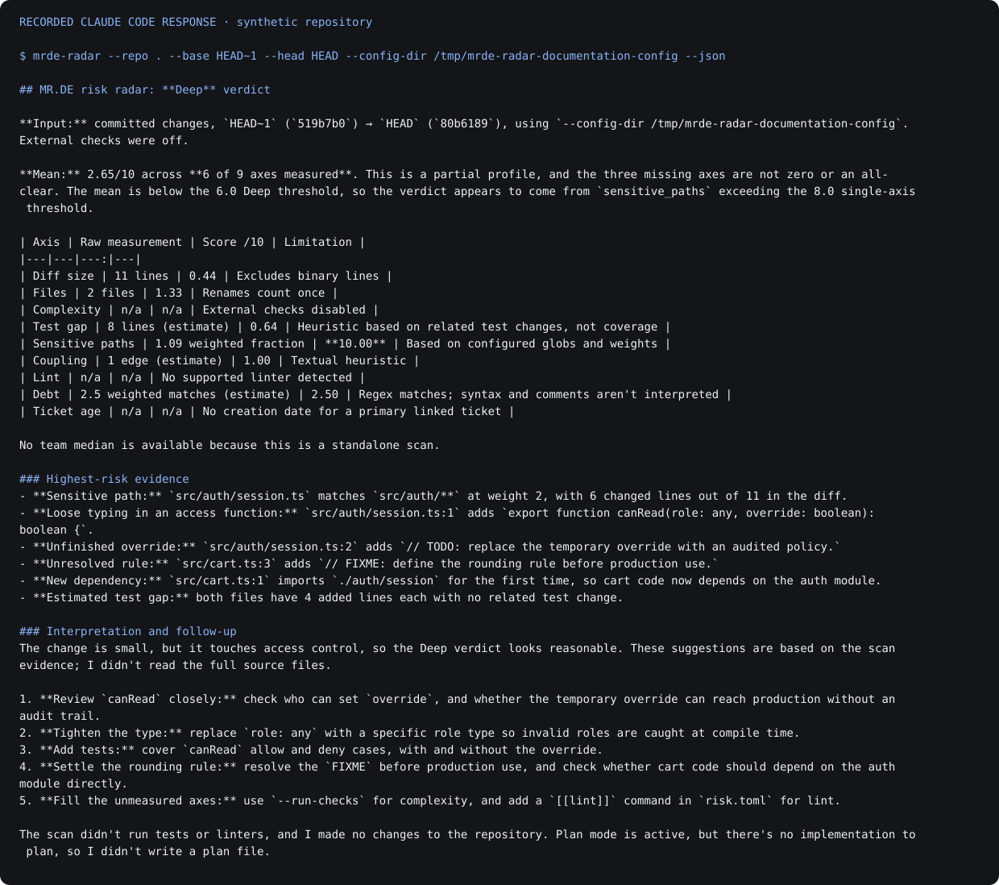
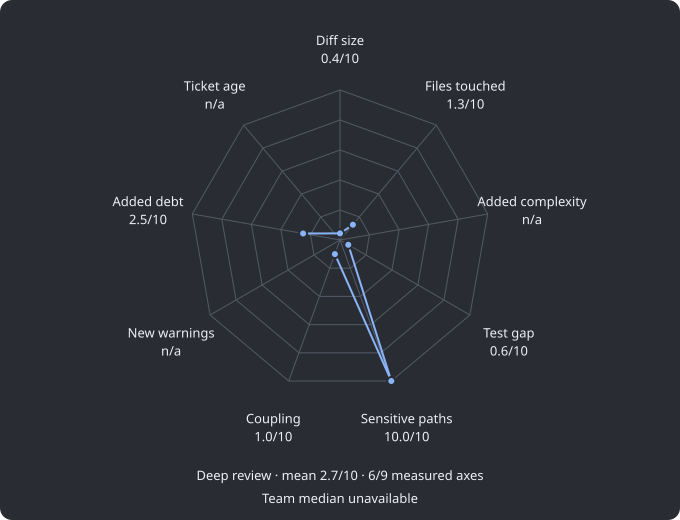

# Recorded radar session in Claude Code

This example was recorded on macOS on 2026-11-07 with the local MR.DE plugin. Claude
invoked `mrde-radar` through its Bash tool and produced the [preserved response](claude-radar-response.md).
The repository is synthetic: two commits change an access helper and a cart calculation.
No forge token, private project or team history is involved.



This image renders the actual final CLI response. It is **not a screenshot of Claude's
interactive UI**. The separate chart below is the real CLI SVG export from the same input.
Session identifiers, environment details and billing metadata are not published.



## What the example demonstrates

Six of nine axes are measured, the mean is 2.65/10, and the sensitive-path score of 10
produces a Deep verdict. Complexity, lint and ticket age remain unavailable. The response
calls out that partial coverage and the absence of a team median. No tests or linters ran;
this is a risk explanation, not an approval or a claim that the code is safe.

## Reproduce the scan

From the MR.DE checkout, create a new fixture directory and install the CLI:

```sh
cargo install --locked --path crates/mrde-radar
python3 examples/radar-demo.py --directory /tmp/mrde-radar-example
mrde-radar --repo /tmp/mrde-radar-example --base HEAD~1 --head HEAD \
  --config-dir /tmp/mrde-radar-example-settings --json
mrde-radar --repo /tmp/mrde-radar-example --base HEAD~1 --head HEAD \
  --config-dir /tmp/mrde-radar-example-settings --format svg > /tmp/example-radar.svg
```

Choose unused directory names. The fixture refuses to modify an existing directory.
Keep the example settings directory empty or absent to avoid loading personal risk rules.
Commit hashes and timestamps vary between runs; the changed source and scoring input do not.

## Reproduce the Claude workflow

Start Claude in the fixture with the absolute plugin directory:

```sh
cd /tmp/mrde-radar-example
claude --plugin-dir /path/to/mr.de/plugins/mrde --permission-mode plan
```

Then invoke:

```text
/mrde:radar HEAD~1 --head HEAD. Use --config-dir /tmp/mrde-radar-example-settings.
```

Allow the read-only radar command when prompted. This step uses the user's installed
Claude Code subscription; normal repository tests do not make model requests. Wording can
vary between sessions. The recorded run used `-p`, `--output-format stream-json`, plan mode,
only the Bash/Skill tools and an empty MCP configuration. It called:

```sh
mrde-radar --repo . --base HEAD~1 --head HEAD \
  --config-dir /tmp/mrde-radar-documentation-config --json
```

To render an independently reviewed stream recording, use
`python3 scripts/render-claude-recording.py /tmp/session.jsonl /tmp/new-output-directory`.
This only exports the final response and radar invocation; it does not run Claude or turn
arbitrary private content into safe documentation. Review the result before publishing.
See [screen provenance](../images/README.md) for source revisions and capture methods.
