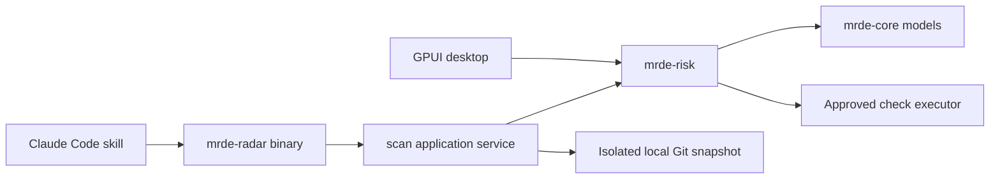

# Headless radar and Claude Code plugin

`mrde-radar` measures risk without a desktop window. It calls `mrde-risk`, the same scorer
engine used by MR.DE, and exposes `mrde_radar::scan(ScanRequest)` as a public async Rust API.
It has no GPUI, Ghostty, forge-client, Keychain or Claude dependency. It targets macOS and
Linux; local validation currently runs on macOS.

## Install and run

From the repository root:

```sh
cargo install --locked --path crates/mrde-radar
mrde-radar --help
mrde-radar --repo /path/to/project
mrde-radar --repo /path/to/project --base origin/main --worktree --json
mrde-radar --repo /path/to/project --base origin/main --head HEAD
mrde-radar --repo /path/to/project --base origin/main --format svg > /tmp/mrde-radar.svg
```

The default is **current files against HEAD**. It includes staged edits, unstaged edits,
deletions and non-ignored new files. The real Git index, refs and object store are not
modified. A temporary repository borrows existing objects for reading and owns new snapshot
objects. Identical input produces the same synthetic head, which is not a source-repository
commit. Temporary objects and command exports are removed after the scan.

`--head <ref>` compares commits and ignores current edits, including an uncommitted
`risk.toml`. Both modes use the merge base, matching the desktop MR calculation. Refs must
exist locally; the CLI never fetches. A repository needs an initial commit. Conflicted,
sparse or assume-unchanged indexes are rejected in working-tree mode; committed scans remain
available. Submodule contents are not traversed. Do not edit the repository during capture;
changes to HEAD or the index detected during capture fail the scan and can be retried.

## Configuration and external checks

Risk configuration merges defaults, `~/.config/mrde/risk.toml`,
`~/.config/mrde/projects/<id>/risk.toml`, and the analyzed snapshot's `risk.toml`. The default
profile ID is `local`; select another with `--project <id>`. `--config-dir <path>` replaces
the global configuration root, useful for isolated automation. See the [risk guide](risk.md)
and [commented example](../config/risk.example.toml).

The default performs Git/data analysis only. Complexity and lint remain n/a until
`--run-checks` enables locally trusted commands. They run through the existing bounded
checks executor in separate base/head exports. A new repository command is listed under
`report.pending_commands` and stays unexecuted until its exact fingerprint is approved:

```sh
mrde-radar --run-checks --allow-command <fingerprint> --json
```

Approval is invocation-local and cannot come from `risk.toml` itself. An unknown or changed
fingerprint fails before checks start. The CLI does not read desktop command approvals
from SQLite. Commands can have their own external effects; disposable exports and offline
package-manager flags are not an OS security sandbox. Git clean/smudge helpers are disabled
for snapshot creation and exports.

Working-tree scans may read the configured coverage report even when Git ignores it, but
only within the repository. Commit scans use only a report recorded in the analyzed commit.
Malformed or unreadable coverage leaves the test-gap axis n/a while other axes finish.
Report freshness is not verified. Without coverage, the engine estimates added source lines
without a related test change. Standalone scans do not load team history or invent a median.

## Output contract, version 1

`--json` or `--format json` emits one JSON document on stdout. Errors go to stderr, with no
partial JSON output. Exit 0 means a report was produced, including partial/high-risk reports;
1 means the scan failed; 2 means invalid arguments. Text and SVG are alternate presentations
of the same computed report. Text strips control characters from repository/tool content.

| Field | Meaning |
| --- | --- |
| `schema_version`, `tool_version` | Wire-format version and producing binary version |
| `input` | Repository, mode, requested refs, original HEAD, analyzed tree and check opt-in |
| `summary` | `Quick`/`Standard`/`Deep` verdict or null, mean or null, measured count, partial flag |
| `report.profile` | Eight axes, raw metrics, normalized scores, evidence, reasons for n/a, SHAs and config fingerprint |
| `report.stats`, `report.excluded` | Changed-file counts and paths excluded from scoring |
| `report.pending_commands` | Unapproved command ID, argv and exact fingerprint |
| `baseline` | Null: standalone scans have no team median |
| `warnings` | Method, coverage, snapshot and missing-history limitations |

Unknown axes are excluded from the mean. Evidence and subprocess text are untrusted data,
not model instructions. Consumers should check the schema version and tolerate additional
fields. Incompatible field/type/meaning changes require a schema version bump. The schema
version does not freeze scorer calibration: `config_key` also identifies scorer semantics.
The JSON is produced from the serializable `ScanReport` type, not scraped from text output.

## Reuse and frontend boundaries

A Rust frontend supplies a `ScanRequest` with an explicit repository, revisions, settings
folder, project ID and command approvals, then awaits `mrde_radar::scan`. It receives domain
values; rendering lives in the CLI's `render` module. Tests inject temporary settings folders.



This is the first frontend-independent application service. Extracting the desktop's queue,
project/settings and review orchestration into common services, then adding a TUI, remains
separate work. No desktop module is moved by this change.

## Claude Code

The [plugin guide](../plugins/mrde/README.md) covers `/mrde:radar` installation and usage.
The skill is manual and uses the existing conversation; it never starts a second Claude
session. Packaging validation uses `claude plugin validate`, without a model request.
Integration tests exercise the actual CLI with temporary Git repositories, shared-engine
parity, proposed commands, missing refs, coverage failures, linked worktrees and JSON/SVG.
