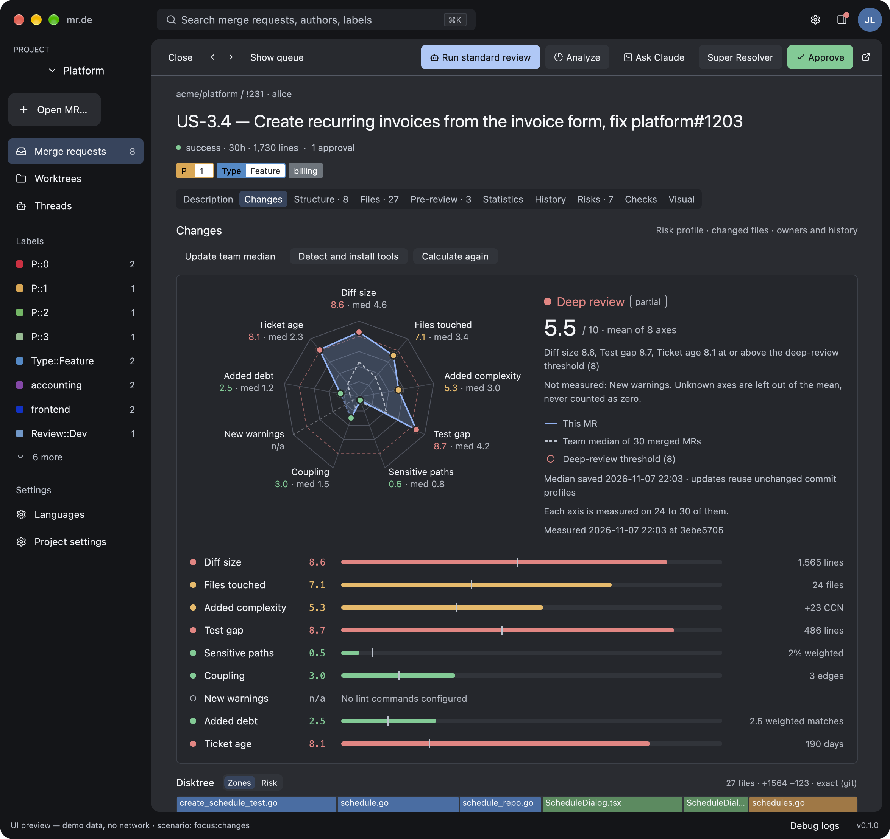
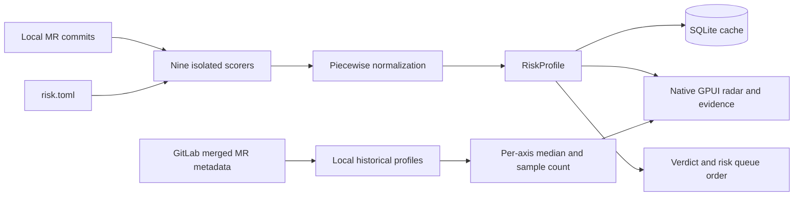

# Merge request risk radar

Open **Changes** and select **Calculate risk**. MR.DE prepares the MR worktree when needed,
then measures the base-to-head change locally. It never starts Claude for this calculation.
The experimental tab keeps the existing Files, Statistics, and History tabs available.

- **Verdict.** The review depth the profile asks for, its mean, and the reason: the axes at
  or above the deep-review threshold, or the mean's position against the thresholds.
  Unmeasured axes are named; they are left out of the mean.
- **Radar.** The blue polygon is this MR, the dashed gray one the team median, and the dashed
  red ring the deep-review threshold. Points are green below the standard-review mean,
  amber up to the deep-review threshold, and red beyond. An unmeasured axis has a dashed
  spoke, reads n/a, and the outline crosses it with a fainter dashed segment: unknown is
  never drawn as zero.
- **Axis table.** Every axis with its score, a bar with the team median as a tick, and the
  measurement behind it (lines, files, CCN, edges…). Hover for the method; click a row or a
  radar label for the evidence.
- **Evidence.** Grouped by file: per-file axes (size, test gap, sensitive paths, complexity)
  on one row each; debt as the added line, coupling as `dependency` or `import` targets,
  warnings with their rule. **Ask Claude about this axis** opens an explicit, interactive,
  read-only discussion in Threads.
- **Changed files.** Largest first, like the Files tab, with a chip per finding (`untested`,
  `debt 2`, `coupling 1`…) colored by the axis severity, and `not scored` on lockfiles and
  generated code. Click a file, a disktree tile, or an evidence file to open its findings,
  line owners from `git blame` at the MR head, and recent commits, those of this MR marked;
  it opens under the row you clicked and loads once per commit. Disktree clicks scroll to
  the opened file, including files beyond the first 60 displayed rows.

## Ticket age and cached medians

The ninth axis, **Ticket age**, uses the creation date of the oldest primary linked issue,
not the MR. At the default thresholds, 30 days scores 0, 90 days scores 4, 180 days scores 8,
and 365 days scores 10. It contributes to the mean, verdict, and risk sorting. This is a
heuristic prompt to revalidate the requirement, not a claim that an old ticket is obsolete.
Override `normalization.ticket_age` in `risk.toml`. Missing dates remain n/a; standalone
CLI scans have no forge issue metadata and therefore leave this axis unavailable.

Opening an MR restores its saved team median from SQLite. **Update team median** checks the
latest merged requests and reuses profiles with the same project, base/head commits and
configuration. Only cache misses run local checks. The requested target tip is mapped to
the actual Git merge base, so divergent branches do not repeatedly miss the cache. An
unchanged median keeps its saved timestamp. Changed configuration invalidates the cache.
Ticket age in historical samples is measured **at merge time**, not today. For an open MR,
age is refreshed when a cached profile is restored, without rerunning technical checks.

Large assets and documentation are not read as dependency manifests. Coupling still
analyzes readable source files when another source exceeds the 1 MiB content limit; its
method lists omitted files and explicitly labels the result a **partial lower bound**.
If no relevant inputs can be analyzed, the axis remains n/a instead of reporting zero.
Bun lockfiles are treated as generated dependency data, not handwritten source.

## Configuration

Copy [the commented example](../config/risk.example.toml) to `~/.config/mrde/risk.toml`.
Overrides merge in this order:

1. Built-in defaults.
2. `~/.config/mrde/risk.toml`.
3. `~/.config/mrde/projects/<project-id>/risk.toml`.
4. `risk.toml` in the MR repository.

Tables merge; arrays replace the earlier array. Unknown fields, invalid curves, globs,
regexes, and verdict thresholds are rejected. Coverage paths are repository-relative.
Project IDs are the IDs in `projects.toml`, not GitLab repository IDs.

Local command definitions are trusted. Commands introduced or changed by repository
configuration remain **Proposed** until **Allow, install and calculate** approves their exact
argument vector and parser. Approval is scoped to the MR.DE project. Programs receive
arguments directly, without an implicit shell. An absolute executable path can still be
configured; ordinary calculations never download tools or dependencies.

## Automatic detection and setup

Select **Detect and install tools** in Changes. MR.DE reads the **changed code in the
reviewed commit**, finds its package manifests, and proposes appropriate lint commands.
It does not execute CI scripts or infer arbitrary `npm run lint` commands. Monorepos can
produce several proposals; untouched packages are not selected. Explicit `[[lint]]`
definitions take precedence; `autodetect_lint = false` disables detection.

| Changed code | Detected check | Preparation after approval |
| --- | --- | --- |
| Rust + Cargo.toml | Clippy JSON | Install Clippy for an existing Rust toolchain; fetch locked dependencies |
| Dart/Flutter + pubspec.yaml | Dart machine diagnostics | Fetch packages using pubspec.lock and the existing SDK |
| JavaScript/TypeScript + declared ESLint | ESLint JSON with the detected runtime | Bun frozen install or npm ci, with lifecycle scripts disabled and the committed lockfile |
| Go + go.mod | go vet JSON | Download module dependencies using the existing Go SDK |
| Python | Ruff JSON | Install a pinned Ruff wheel in the managed cache |

Lizard is installed in an isolated Python environment under the MR.DE cache, then reused.
Ruff uses its own environment. Existing user tools are detected even when Finder's PATH
omits Homebrew, ~/.local/bin, ~/.cargo/bin, ~/.bun/bin or the default FVM SDK. No shell profile is
modified. Python 3 and the applicable language SDK must already exist; MR.DE does not
silently install a full SDK or substitute a different package manager.

Detected checks stay **Proposed**. **Allow, install and calculate** approves their exact
command, package directory, parser and preparation recipe, prepares both commit snapshots,
then calculates the profile. Setup may download packages; the subsequent check uses offline
package-manager settings. Lockfiles are required for Bun, npm, Cargo and Dart dependency setup.
A failed installation is shown with a retry path and leaves the relevant axis n/a; other
axes still finish. Cancellation stops the subprocess group. User worktrees are unchanged.

JavaScript detection reads `packageManager` first, then `bun.lock`/`bun.lockb`,
`package-lock.json`/`npm-shrinkwrap.json`, `pnpm-lock.yaml` or `yarn.lock`. Conflicting
lockfiles require an explicit `packageManager`; unsupported managers produce a specific
message instead of falling back to npm. Bun and npm are currently supported for automatic
setup. Workspace membership determines the install root, while the lint command retains
its package directory. The install root is included in the approval fingerprint.

Bun runs ESLint directly and installs with `--frozen-lockfile --ignore-scripts`.
See the [Bun install documentation](https://bun.sh/docs/pm/cli/install) and
[lockfile formats](https://bun.sh/docs/pm/lockfile). After preparation, **Calculate again**
reuses cached dependencies, including with Bun 1.3.3 which has no `--offline` option.
This also works after restarting MR.DE. The cache stores only `node_modules` trees,
including workspace links, under `risk-tools/bun-dependencies-v1` in the MR.DE cache.
Each calculation receives an independent copy; a linter cannot change the cached tree.
Bun runs ESLint with `--no-install` so the runtime cannot fetch a missing dependency.

Cache entries are tied to the exact commit, approved command, Bun version and platform.
A changed input requires preparation again. Missing or damaged entries show a setup action;
MR.DE never substitutes `--prefer-offline` or silently downloads during a calculation.
**Detect and install tools** rebuilds entries, and the cache directory may be removed to
reclaim space. Each entry is limited to 2 GiB. An interrupted preparation is never reused.
Bun itself must already be installed. No lockfile is converted and no lifecycle script runs.

Tool preparation is a separate action from **Calculate again** and background refresh.
The CLI exposes the same explicit preparation through `--run-checks --prepare-tools`;
proposed commands additionally require `--allow-command <fingerprint>`.

Each external tool runs through `mrde-checks` in its own disposable base/head snapshots.
Timeouts and cancellation kill its process group. Output is bounded; package-manager
offline flags are set during scoring. Only explicit tool setup downloads packages. Git, HTTP, disk reads,
and subprocesses stay off the GPUI thread. Scoring itself has no network client or Git
fetch; initial worktree preparation uses the existing SSH workflow.

## Reading the measurements

Every axis runs from 0 to 10: higher means riskier. Piecewise-linear normalization clamps
outside the configured endpoints. The default review depth is **Deep** when any known
axis reaches 8 or the known-axis mean reaches 6; **Standard** starts at 3.5, otherwise
**Quick**. Missing axes stay **n/a**, are excluded from means, and make the verdict partial.
These measurements guide review depth; they do not establish correctness or safety.

| Axis | Measurement and limits |
| --- | --- |
| Diff size / files | Merge-base-to-head `git diff --numstat`; renames count once. Binary files have no line counts. |
| Complexity | Net cyclomatic complexity delta from Lizard XML; negative deltas normalize to zero. Missing reports for any changed source file make this axis unavailable. |
| Test gap | Untested changed lines. With a configured LCOV/Cobertura report: changed executable lines it marks as uncovered (report freshness cannot be proven). Without one, an explicitly marked heuristic: added source lines whose file has no related test change in the MR. A test file is related when it has the same name (`user_test.go`, `User.test.tsx`, `tests/user.rs`), lives in the file's own module directory (`src/user/tests.rs` for `src/user.rs`), or is a generic `tests.rs` beside it; inline tests (`#[cfg(test)]`, `#[test]`, `describe(`, `def test_`, `func Test`) count too. A two-line fix without tests scores near zero; a large untested change scores high. |
| Sensitive paths | Changed-line share weighted by the highest matching glob, without counting overlapping rules twice. |
| Coupling | Added Cargo/npm/Dart/Go dependencies, plus modules that existing product files import for the first time (`serde`, `crate::store`), each counted once per file. A new file's imports describe the new module and do not count; standard-library and `self`/`super` imports are ignored. Explicitly heuristic, not a compiler-resolved dependency graph. |
| Conventions | New diagnostics by path, rule and message compared with base. Line shifts alone do not add warnings. JSON, Clippy, ESLint and regex output are supported. |
| Debt | Weighted regex matches on added product-code lines; test files and Rust inline test modules (from `#[cfg(test)]` on) are skipped. Matches may include comments and strings. The default `any` rule matches TypeScript's `any` type only. |

No axis counts lockfiles, generated or vendored code (`Cargo.lock`, `go.sum`, `*.pb.go`,
`vendor/`, `node_modules/`, `mocks/`…), nor files matching `exclude`: the axis methods say
how many were left out, and the file list marks them `not scored`. Changing what a scorer
measures changes the configuration fingerprint, so cached profiles are measured again.

Click **Update team median** to request the most recent merged MRs from GitLab, ordered
by merge time (GitLab versions supporting `order_by=merged_at`). The default sample is 30,
scoped to the GitLab repository and MR.DE project. Only commits already present in the
local object database are measured; missing commits are reported in the debug log and
excluded per axis. The radar shows each axis's sample count. Historical test gaps use
the file-ratio heuristic because a current coverage report cannot describe old commits.
A sparse baseline is not representative of the whole team.

Queue miniatures draw the same polygon from cached scores only;
**Risk** sorts measured MRs from highest mean to lowest, with unavailable scores last.
SQLite stores full profiles by project, repository, MR, base/head SHA, and configuration
fingerprint. **Calculate risk** explicitly recomputes when local reports or tools change.

## Validation

`cargo test --locked -p mrde-risk` includes diff fixtures, all scorer types, report parsers,
and a two-commit repository with a dirty worktree and a timed-out tool.
`cargo test --locked -p mrde --lib` covers axis selection, calculation, file history and
image/reader scrolling. Preview the panel with `MRDE_SCENARIO=focus:changes cargo run
--locked -p mrde -- --ui-preview`. The scorer crate and native drawing use portable APIs;
the complete desktop application's existing macOS integrations are not Linux-validated.

Preview variations: `MRDE_SCENARIO_FILE=first` opens file ownership/history;
`MRDE_SCENARIO_AXIS=debt` shows an axis's evidence (`lint` an unavailable one);
`MRDE_SCENARIO_FRESH=1` shows the tab before any calculation. `MRDE_SCENARIO_RISK_FILE=<report.json>`
loads a locally measured report in preview mode only, without credentials.

