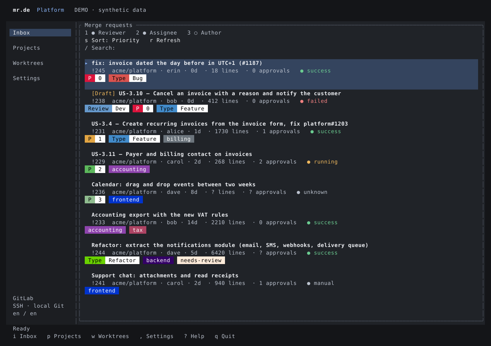
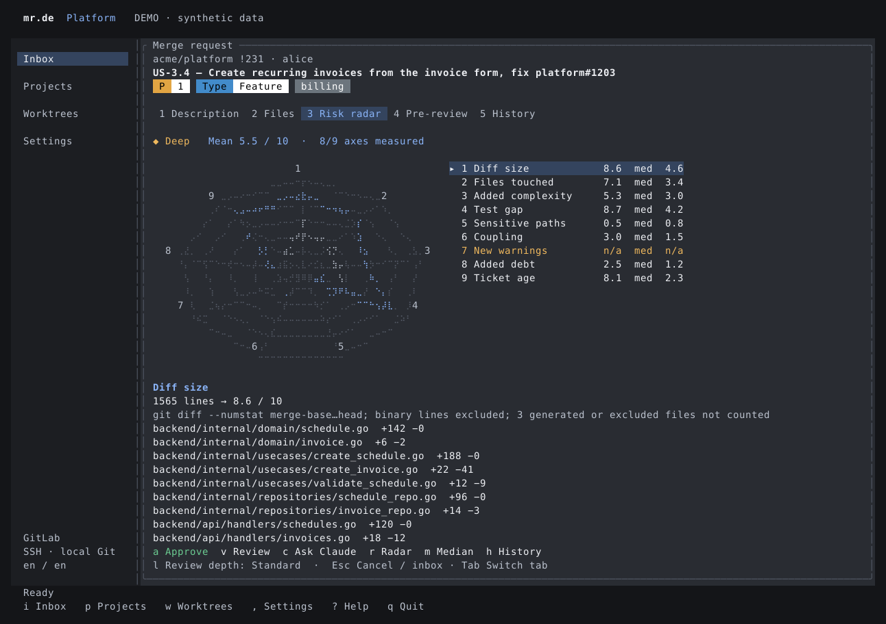

# Interactive terminal cockpit

`mrde-tui` is a real Rust frontend built with Ratatui 0.30 and Crossterm 0.29, the same
library family used by [Codex](https://github.com/openai/codex/blob/main/codex-rs/tui/Cargo.toml).
It uses `mrde-service` for projects, queues, MR details, worktrees, reviews, approvals and
risk reports. It does not depend on GPUI or embedded Ghostty. This first version is built
and tested on macOS; the shared credential adapter still needs Linux support.



## Start

```sh
cargo run --locked -p mrde-tui -- --demo
cargo run --locked -p mrde-tui -- --demo --screen radar
cargo run --locked -p mrde-tui -- --project platform
cargo run --locked -p mrde-tui -- --language fr --information-language en
```

Projects and language preferences are shared through `~/.config/mrde/projects.toml`.
Configure connections in the desktop settings or edit non-secret TOML. The terminal lets
you switch projects, update role/sort preferences and save independent languages. It does
not yet provide a connection editor, image lightbox, embedded Threads or Super Resolver.

For credentials saved by the provisioned Touch ID application, use its signed companion:

```sh
./target/macos/mr.de.app/Contents/MacOS/mrde-tui
```

`scripts/package-macos.py` packages and signs both executables with the same entitlement
and identity. An ordinary `cargo run` binary uses the legacy Keychain backend and cannot
read the protected Touch ID item. No credential is copied into a file or environment
variable. Live protected-keychain use remains a manual verification; automated tests use
injected settings and executors.

## Controls and examples

| Context | Keys and behavior |
| --- | --- |
| Anywhere | `i` inbox, `p` projects, `w` worktrees, `,` languages, `?` help, `q` quit |
| Inbox | `↑`/`↓` or `j`/`k`, `Enter` open, `/` search titles/authors/labels, `s` cycle sorting |
| Inbox roles | `1` reviewer, `2` assignee, `3` author; at least one stays selected |
| Reader | `1` description, `2` files, `3` radar, `4` pre-review, `5` history; `Tab` cycles |
| Scrolling | Wheel, arrows, `PgUp`/`PgDn`, `Home`/`End`; wrapped lines remain reachable |
| Risk | `r` calculate, `m` update cached median, `←`/`→` select axis, `c` ask Claude about it |
| Tool setup | `t` prepare tools, `y` authorize the first proposed lint command; each requires confirmation |
| Review | `l` choose Quick/Standard/Deep, `v` run explicitly, `h` analyze history |
| Chat | `c` prepares context and opens Claude in the current terminal in plan mode; exit Claude to return |
| Approval | `a` opens confirmation with the exact SHA; `y` confirms, `n`/`Esc` cancels |
| Languages | `1` interface, `2` Claude responses, `s` save; independent of credentials |

Mouse clicks select menus, requests, tabs and axes. `Esc` cancels a cancellable operation
or returns to the inbox. Network and subprocess work run on a worker runtime; a pending
refresh does not block settings or navigation. Results for an old selection are ignored.
Only visible queue rows are rendered. Narrow terminals show scrollable risk measurements;
larger terminals add the chart. Unknown measurements stay n/a.



To explore a complete workflow without external effects, start `--demo`, open a request,
press `r`, switch to its radar with `3`, select an axis, then visit files (`2`) or run a
simulated review (`v`). Demo approval is simulated; demo chat never launches Claude.

## Reproducible references

```sh
cargo run --locked -p mrde-tui -- --demo --screen radar --snapshot /tmp/tui-radar.svg
cargo run --locked -p mrde-tui -- --demo --screen settings --language fr --snapshot /tmp/tui-languages.svg
cargo test --locked -p mrde-tui
```

SVG exports come from the **actual Ratatui buffer**, not a separate mockup. `--width` and
`--height` set columns and rows (default 140×44). Exports require `--demo`. The tests cover
keyboard workflows, stale responses, responsive worker execution, exact-SHA confirmation,
scrolling and English/French rendering at 80×24, 100×32 and 140×44.
