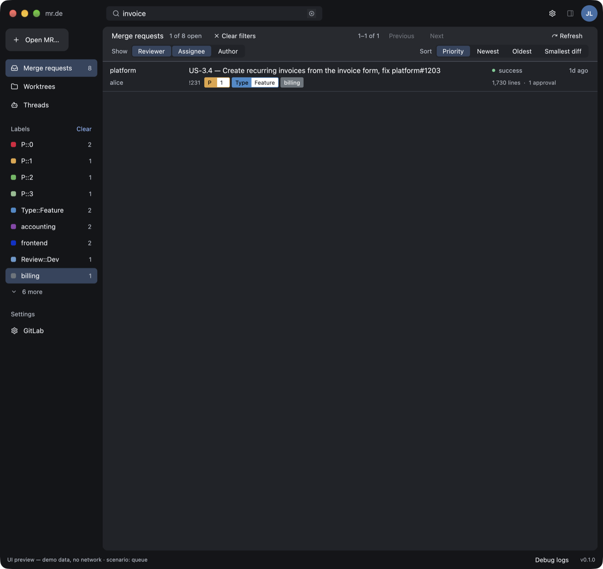
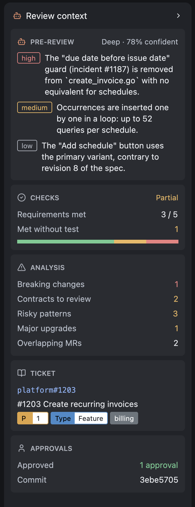
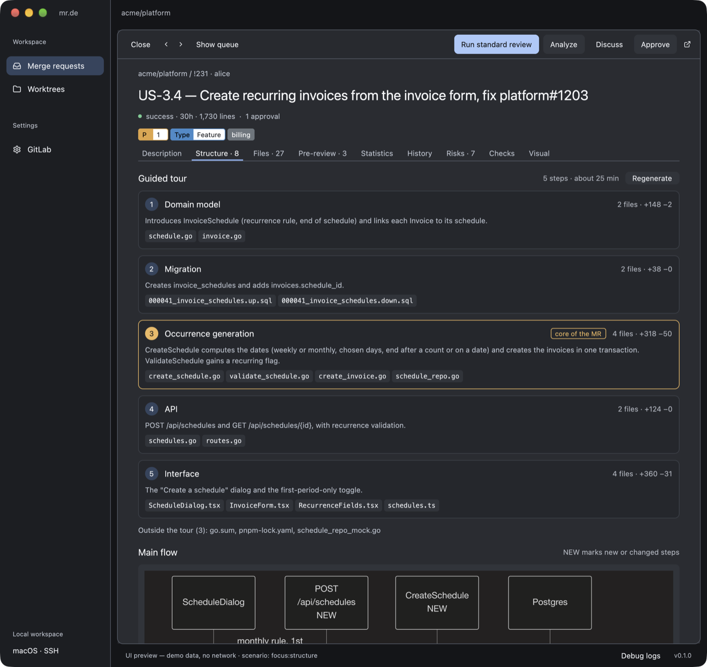
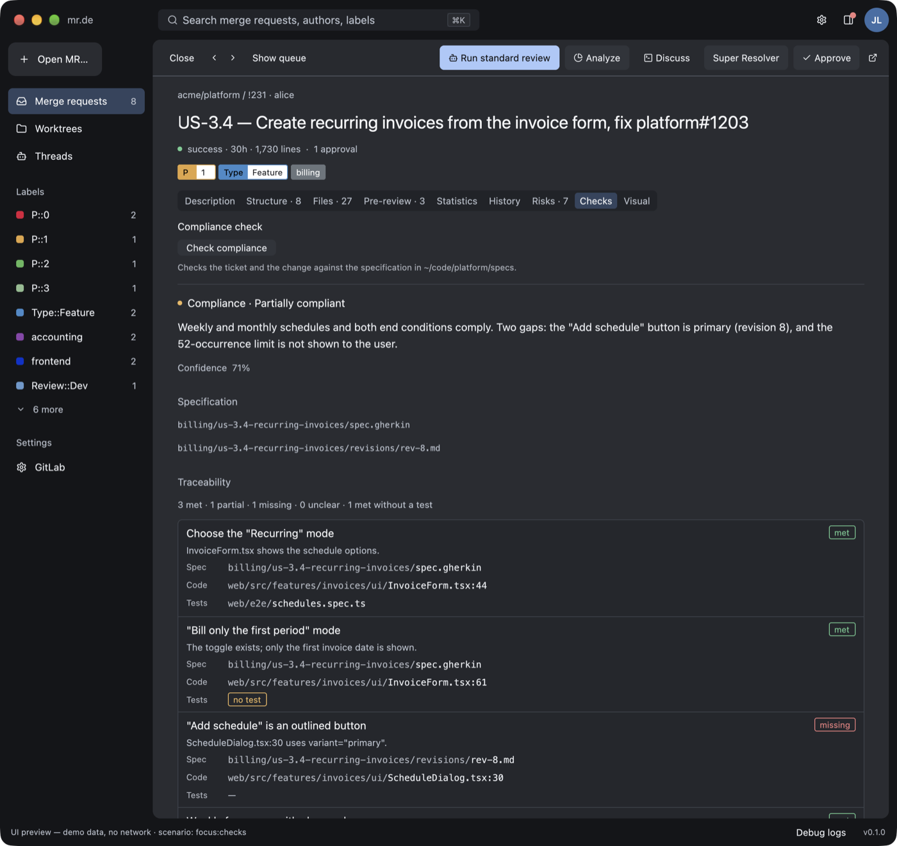

# User guide

- [Configuration](#configuration)
- [Review workflow](#review-workflow)
- [Queue, labels, and priority](#queue-labels-and-priority)
- [Search, label filters, and opening any merge request](#search-label-filters-and-opening-any-merge-request)
- [Reader](#reader)
- [Review context panel](#review-context-panel)
- [Pre-review with Claude](#pre-review-with-claude)
- [Understanding complex merge requests](#understanding-complex-merge-requests)
- [Specification compliance](#specification-compliance)
- [Visual comparison](#visual-comparison)
- [Ask Claude](#ask-claude)
- [Approval](#approval)
- [Worktrees and cache](#worktrees-and-cache)
- [Debug logs](#debug-logs)

## Configuration

A project is a review workspace: one provider, connection, optional group, and independent
review preferences. Use the **PROJECT** selector above the sidebar menus to switch projects,
or choose **New project**. Name it, select a provider, enter its URL, and click **Save**.
Rename or edit the selected project in **Project settings**. Switching discards unsaved form
edits and clears secret inputs; saving keeps their masked values visible.

Both **GitLab** and **GitHub** are supported. For GitLab, **Group / organization** optionally
limits the queue to a group and its subgroups (e.g. `team/platform`); empty means all
accessible groups. For GitHub, it takes an owner (`acme`, a user or an organization) or one
repository (`acme/platform`); empty means every repository you can see. This is a queue
filter, not a permission boundary: **Open MR…** can still open other repositories on the same
instance.

**Test connection** checks authentication and access to the selected group without saving.
**Save** writes settings without an HTTP request. Both show progress and errors. A GitLab
personal access token typically needs `api` scope; SSH access for Git is independent.

For GitHub, enter `https://github.com` or your GitHub Enterprise Server address (its API is
under `/api/v3` and `/api/graphql`). A classic token needs the `repo` scope (`public_repo` for
public repositories only). A fine-grained token needs read access to **Pull requests**,
**Contents**, **Issues**, **Commit statuses**, and **Checks**, plus write access to **Pull
requests** to approve. Cloudflare Access fields apply to GitLab only and are hidden for
GitHub.
Cloudflare Access service-token fields are optional. A blank secret keeps the value saved
for **this project**. **Remove saved Cloudflare credentials** explicitly clears that pair.
Tokens stay in Keychain, never TOML or SQLite; two projects on the same host do not share them.
See [Touch ID](touch-id.md) for signed builds.

Non-secret configuration lives in `~/.config/mrde/projects.toml`:

```toml
version = 1
active = "platform"

[[projects]]
id = "platform"
name = "Platform"
provider = "gitlab"
url = "https://gitlab.example.com"
group = "team/platform"
refresh_seconds = 120
claude_path = "claude"
mr_roles = ["reviewer", "assignee"]
mr_sort = "priority"
spec_path = ""
visual_command = ""

[[projects]]
id = "community"
name = "Community"
provider = "github" # profile only for now
url = "https://github.com"
group = "example-org"
```

- Use stable, unique IDs containing letters, digits, underscores, or hyphens. Renaming a
  project's display name preserves its credentials and history. Changing its ID creates a
  different storage identity; changing provider or URL requires its own credentials.
- An existing `config.toml` is imported as **Default project** (`id = "default"`), retaining
  credentials and existing caches. The first save or project selection creates `projects.toml`;
  the legacy file stays untouched and is then ignored. `default` is reserved for that import.
- **Refresh interval** is seconds, at least 30; **Claude executable** accepts a command or
  absolute path. Both are editable in the form. The toolbar saves roles and sorting only
  for the current project, without accessing Keychain.
- **Specification folder** must exist when saving; empty disables compliance checks.
  **Screenshot command** configures [visual comparison](#visual-comparison).
- Queues, worktrees, analyses, and Threads are isolated per project and group. Changing a
  group does not delete old worktrees. Background reviews and resolver sessions continue in
  their originating project when you switch; return to it to inspect their results.
- Restart after editing TOML. To remove a profile, remove its `[[projects]]` table and point
  `active` to a remaining ID. This does not delete Keychain entries or worktrees.

## Review workflow

1. Connect GitLab. The queue refreshes at startup and periodically; cached merge requests
   stay visible meanwhile, and navigation is never blocked by a refresh.
2. Select a merge request to read its description, linked issues, and changed files.
3. Choose a depth in **Pre-review** and click **Run review**.
4. For a large merge request, click **Analyze**, then **Generate tour** in **Structure**,
   and read **History** and **Risks**. For interface changes, click **Capture screenshots**
   in **Visual**.
5. Click **Check compliance** in **Checks** to compare the ticket and the change with your
   specification.
6. Click **Ask Claude** to ask Claude Code about the merge request in **Threads**.
7. Click **Approve**, check the merge request and commit in the confirmation, then confirm.

## Queue, labels, and priority

The queue lists open merge requests, including drafts, where you hold one of the selected roles,
deduplicated across roles and projects. Each row shows the project, author, title, labels,
pipeline, age, diff size, and approval count. Drafts have an explicit **Draft** badge. The
queue shows 25 merge requests per page; sorting applies to the whole queue before pagination.

Sorting options:

- **Priority** (default): numeric priority labels first (`P0` before `P1`; both `P0` and
  `P::0` are recognized), then pipeline readiness, age capped at 30 days, then smaller diffs.
  Other labels have no effect on ranking.
- **Newest**, **Oldest**, or **Smallest diff** (unknown sizes last).
- **Approvals**: fewest first, with unknown counts last and priority breaking ties. The
  queue reorders after an approval. Set `mr_sort = "approvals"` in the project TOML.
- **Risk**: highest measured risk first, with unknown or outdated scores last.

A merge request shows its own labels followed by those of the ticket it implements, because
many teams label tickets rather than merge requests. The ticket is the related issue
referenced in the merge request title (for example `fix web-app#3436`), else in its
description, else the only related issue. Issues merely mentioned elsewhere are ignored, so
their statuses and priorities do not leak in. Both `/-/issues/` and `/-/work_items/` links
are recognized. Priority sorting uses merge request and ticket labels.

Queue rows show one line of labels, priority first, then `+N`; the reader lists all of them.
Label colors come from GitLab. The merge request list returns them directly; the single-MR
and related-issue endpoints return names only, so mr.de colors them from the project's labels
(including parent groups), cached for ten minutes per project. A scoped label such as
`Review::Dev` shows two adjoining segments: the scope in the label color, the value on white.

## GitHub pull requests

A GitHub project lists open pull requests, including drafts, with the same roles: **Reviewer** covers
pending review requests (yours or your team's) and pull requests you have already reviewed,
**Assignee** and **Author** are what they say. One GraphQL search per role returns each pull
request with its labels and colors, latest reviews, check status, and size, so a refresh costs
a few requests whatever the number of pull requests.

- **Pipeline**: the combined status of checks and commit statuses on the head commit
  (success, failed, running, pending).
- **Approvals**: reviewers whose latest decisive review approves the pull request.
- **Ticket**: the issues the pull request closes (`Fixes #3` or linked manually), with their
  labels.
- **Diff base**: the merge base of the two branches, as GitLab reports it, so analyses compare
  only the pull request's changes.
- **Approve** submits an approving review bound to the reviewed commit, and refuses if the pull
  request has a newer head commit.
- Worktrees fetch `refs/pull/<number>/head` from the target repository, which also covers
  forks. **Open MR…** accepts pull request links and `owner/repo#123`.

## Search, label filters, and opening any merge request

The search field in the title bar (**⌘K**) filters the queue as you type. Every word must
appear in the merge request number (`!231`), title, project, author, or one of its labels,
ignoring case; descriptions are not searched. **Escape** clears the search.



The sidebar lists the labels of the queue, merge request and ticket labels together, with
the number of merge requests carrying each: priority labels first, then the most frequent.
Click labels to keep only the merge requests carrying all of them; **Clear** removes the
label filters, and **Clear filters** above the queue removes the search as well. Pagination
and the reader's previous and next arrows follow the filtered list.

**Open MR…** (**⌘O**) opens a merge request outside your queue. Paste its link, for example
`https://gitlab.example.com/group/project/-/merge_requests/123`, or a reference such as
`group/project!123`. Links must belong to the configured GitLab instance: others are refused
before any request. A merge request opened this way stays open across refreshes until it
gets a new commit.

## Reader

Selecting a merge request shrinks the queue and opens the reader below it. **Focus** hides
the queue and **Show queue** restores it; the arrows move to the previous or next merge
request across pages; **Close** returns to the full queue. The reader has these tabs:
Description, Structure, Files, Pre-review, Statistics, History, Risks, Checks, and Visual.
After an analysis, tab labels show counts; hover them for details.

Descriptions, issues, and Claude's prose render Markdown: headings, emphasis, links, lists,
task lists, tables, quotes, code blocks, and Mermaid diagrams (top-level ```` ```mermaid ````
blocks, rendered without a browser).

Images resolve relative to the document's project. GitLab uploads such as
`/uploads/<secret>/image.png` are downloaded through the authenticated uploads API (GitLab
17.4 or later), including Cloudflare headers; public HTTP images load without credentials.
Downloads run in the background, four at a time, up to 10 MiB each. Clicking an image opens
a centered viewer that fits the entire image inside the window, preserving its proportions.
Hover over the image for a **+ magnifier** and click the detail to enlarge: 2×, 4×, then 8×.
At 8× the cursor becomes a **− magnifier**; the next click returns to the fitted view. Zoom
stays anchored at the point clicked. Hold the left mouse button and drag to pan; the cursor
becomes a grabbing hand, and releasing a drag never triggers a zoom. Pan stops at the edges.

The toolbar's **Zoom**, **−**, and **Fit** controls remain available. The percentage is
relative to the fitted view. Trackpad, wheel and scrollbars still move a zoomed image.
**Escape** closes the viewer and returns to the same position in the description.

**Statistics** shows the *Disktree*, a treemap of changed lines per file grouped into zones
(directories). It is estimated from GitLab diffs at once; **Compute statistics** replaces the
estimate with exact `git diff --numstat` counts from the merge request worktree. After an
analysis, the Disktree can be colored by file risk instead of zone.


## Review context panel



The panel on the right of the reader summarizes the open merge request:

- **Pre-review**: the three most severe risks found by Claude, with the depth and
  confidence.
- **Checks**: the compliance verdict, requirements met, and those met without a test.
- **Analysis**: breaking changes, contracts to review, risky patterns, major upgrades, and
  overlapping merge requests.
- **Ticket**: the ticket the merge request implements, with its labels; click it to open it
  in GitLab.
- **Approvals**: the approval count and the commit being reviewed.

Section titles open the matching tab. The panel button in the title bar, the chevron in the
panel, or **⌘⌥B** shows and hides it. On windows at least 1360 points wide the panel sits
beside the reader; collapsed, it leaves a rail of icons whose counters show risks, missing
requirements, analysis findings, and approvals. On narrower windows the panel starts hidden
and floats over the reader when opened; below 1200 points the rail is hidden too, and a dot
on the title bar button signals risks or gaps.

The avatar in the title bar shows the GitLab account of the token, identified by the first
refresh.

<br clear="right">

## Pre-review with Claude

Choose **Quick**, **Standard**, or **Deep**, then click **Run review**. mr.de verifies the
source and base commits, creates or reuses a detached worktree, and runs Claude only when no
cached result exists for that commit and depth. The result shows a summary, the intention,
risks ranked by severity, files to read first, and a confidence level. Selecting a merge
request shows the most thorough cached review for its commit.

The command is `claude -p <fixed instructions> --output-format json` with the read-only
`Read`, `Glob`, and `Grep` tools. The merge request context, including diffs against the
base commit, is sent on standard input and never in process arguments. Budgets per depth:

| Depth | Per file | Total | Timeout |
|---|---|---|---|
| Quick | 8,000 characters | 60,000 | 5 minutes |
| Standard | 20,000 | 200,000 | 10 minutes |
| Deep | 40,000 | 400,000 | 20 minutes |

Truncated diffs are marked so Claude reads those files in the worktree. Malformed output,
CLI errors, and invalid confidence values are rejected. Claude is told not to claim that
tests ran. A worktree with local changes cannot produce a fresh analysis.

## Understanding complex merge requests

**Analyze** (toolbar, or the button shown in an analysis tab) reads the merge request
worktree with read-only Git commands, without Claude, and fills three tabs. Only the search
for overlapping merge requests contacts GitLab.

### Structure



- **Guided tour** (Claude, on click): the change grouped into three to seven reading steps,
  the core step highlighted, files you can skip, and the main flow as a Mermaid diagram.
- **Changed symbols**: functions, methods, types, and classes added, removed, modified, or
  with a changed signature (shown before and after), for Go, TypeScript and JavaScript,
  Rust, and Python.
- **Impact**: callers of modified, removed, or re-signed definitions at the merge request
  commit, flagging those the merge request did not touch.
- **File graph**: imports between changed files, plus HTTP calls from client code to
  endpoints declared by the merge request.

### History


- **Why was it there?**: for the largest removed blocks, the commit, author, and `#issue` or
  `!merge request` references that introduced them (`git blame` on the base commit).
- **Risk by file**: six months of target-branch history (changes, fix commits, authors).
- **Who knows this code**: top authors per changed area over twelve months, plus
  `CODEOWNERS` owners.
- **Overlapping merge requests**: open, or merged in the last 14 days, touching the same
  files. A merge request merged after this one started may require a rebase.

### Risks

- **Contracts**: database migrations (`NOT NULL` without default, renames, drops,
  non-concurrent indexes, missing down scripts), added and removed HTTP endpoints, OpenAPI,
  GraphQL, and Protobuf removals, environment variables missing from env samples, and
  permission strings.
- **Dependencies**: direct dependency changes in `go.mod`, `package.json`, `Cargo.toml`, and
  `requirements.txt`, with major upgrades flagged, and lockfile counts.
- **Risky patterns** in added lines only: queries or `await` in loops, ignored Go errors,
  empty catch blocks, `useEffect` without dependencies, hardcoded secrets, `unwrap`, `eval`,
  raw HTML, debug output, and more.

Analysis results are cached per commit and restored when the merge request is selected
again; they are never shown for another commit.

## Specification compliance

Set a **Specification folder** in Settings, then click **Check compliance** in **Checks**.
Claude reads the folder (Markdown, Gherkin, or YAML), finds the documents covering the
ticket, and reports a verdict and a traceability matrix: for each requirement or Gherkin
scenario, the specification file, the implementing code (`path:line`), the tests, and a
status (met, partial, missing, unclear). Requirements met without a test are flagged.



## Visual comparison

Set a **Screenshot command** in Settings. **Capture screenshots** in **Visual** runs it with
`/bin/sh -c` in a worktree of the base commit and one of the merge request commit (created
if missing). Each run gets `MRDE_SCREENSHOTS_DIR`, an empty output folder, and `MRDE_SIDE`,
`before` or `after`. The command must write PNG files there (subfolders allowed) within 20
minutes. Files with the same relative name are compared pixel by pixel; channel differences
up to 16 count as unchanged. Each screen shows before, after, and a difference image.

The command comes only from your configuration, never from the repository, and runs only
when you click. mr.de does not start servers or seed data: your command must do it.

## Ask Claude

**Ask Claude** creates a **Questions** thread and opens Claude Code in the embedded
terminal of **Threads**, in the merge request's review worktree. mr.de first writes the
merge request context (description, issues, existing pre-review) to
`~/Library/Caches/mrde/context/`, outside the worktree, and starts
`claude --session-id <id> --permission-mode plan --add-dir <context dir>` with a fixed first
message asking Claude to read it, then wait for your questions. Only fixed text and
application-built paths reach the command line, so merge request text is never interpreted
by a shell.

The session is read-only: in plan mode, Claude Code reads and searches the code but does
not edit it, so the review worktree stays clean for reviews and analyses. Switching mode
inside Claude Code (Shift+Tab) is your decision. A questions thread never rebases, commits,
pushes, or follows a pipeline.

Clicking **Ask Claude** again for the same commit returns to the same thread and resumes
its session (`claude --resume <id> --permission-mode plan`); **Open terminal** in
**Threads** does the same later. A new commit gets a new thread.

## Super Resolver and Threads

Click **Super Resolver** in the selected MR's action bar to start. This action authorizes
rebasing and pushing fixes to that MR's source branch. MR.DE checks the selected SHA,
creates a separate writable worktree, rebases onto the target, and asks Claude to resolve
conflicts when necessary. Every push uses the expected source SHA as a lease: concurrent
changes cause a stop, rather than being overwritten. The target branch is never pushed.

The runner polls GitLab every 15 seconds. A failed pipeline supplies the last 40 KB of up
to five required failed jobs to Claude. Corrections are committed and pushed, then the
runner follows the new commit's pipeline. Conflicts and pipeline fixes share a limit of
**three Claude attempts per run**. Questions, permissions, missing pipelines, manual jobs,
errors, and exhausted attempts stop the loop in **Needs your input**. Nothing approves or
merges the MR automatically.

Open **Threads** from the left menu. Select a thread for its timeline or a Claude session
for its output. **Take over** stops automation before opening that same session inside
MR.DE's native Ghostty terminal. **Open terminal** resumes a stopped session in its worktree
with `claude --resume`. You can type answers, review permission requests, and make edits.
Exit Claude or use **Close terminal**, then click **Resume · 3 attempts** to allow another
bounded run. Manual edits are preserved and committed before the next rebase.

**Stop** preserves worktrees and session IDs. Closing MR.DE stops its automation; persisted
active threads become **Interrupted** on the next launch and require a manual Resume.
Navigation and ordinary reviews remain available while a resolver is running. Saving a
connection change stops existing runs. Ghostty fonts and key bindings follow your Ghostty
configuration; MR.DE applies its own terminal colors. The embedded terminal does not require
opening a separate Ghostty window.

## Approval

**Approve** opens a confirmation showing the merge request and the commit SHA. Confirming
sends the approval bound to that SHA; GitLab rejects it if the merge request changed in the
meantime. mr.de never merges. Approval availability depends on your GitLab edition and
project permissions.

## Worktrees and cache

- Cache and history: `~/Library/Caches/mrde/mrde.sqlite3`.
- Bare repositories and detached worktrees: `~/Library/Caches/mrde/git/<instance hash>/`,
  one worktree per merge request commit.
- Resolver worktrees: `~/Library/Caches/mrde/resolver/<instance hash>/<thread ID>/`.
  They are retained for manual continuation and excluded from the review worktree cleaner.
- Screenshots: `~/Library/Caches/mrde/visual/`.

The **Worktrees** page lists mr.de worktrees with their local-change state. **Clean** removes
one worktree and refuses if it contains local changes or ignored files; bare repositories
remain. Close any terminal session using a worktree before cleaning it. Listing and cleaning
worktrees and computing statistics do not contact GitLab.

## Debug logs

**Debug logs** in the footer toggles a bounded, timestamped panel with connection and save
stages and the start and result of every action. Errors from actions you start open it
automatically; periodic refresh errors stay in the status line. HTTP bodies and
authentication headers are never logged, and secrets are redacted from error text. Logs are
kept in memory only. Set `RUST_LOG=mrde=debug` for more detail on standard error.

### Closing Threads

Use **Close thread** in the thread toolbar to stop its worker, close all its embedded
terminals, and move it to **Closed threads**. Its worktree and session history remain
available, including after restarting MR.DE. **Reopen thread** returns it to the open
list; use **Open terminal** or **Resume** explicitly to continue. **Close terminal**
only closes the selected terminal and leaves the thread open.
