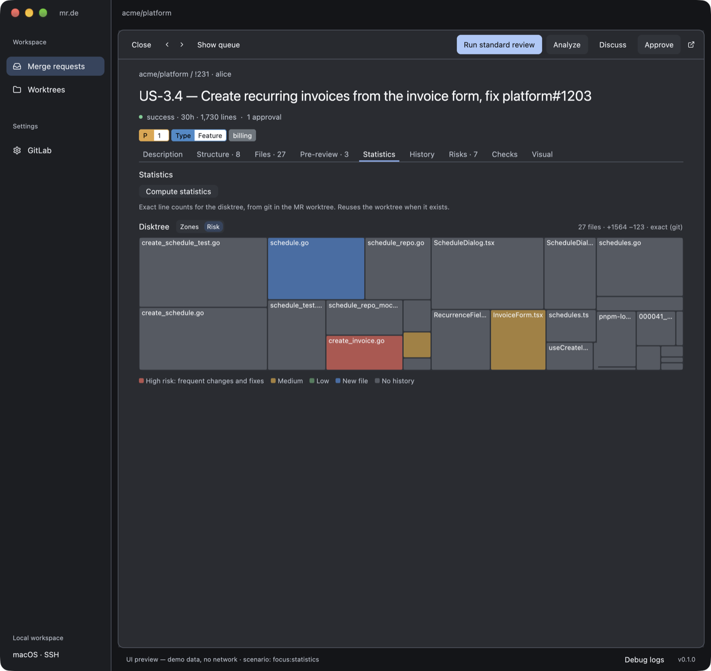
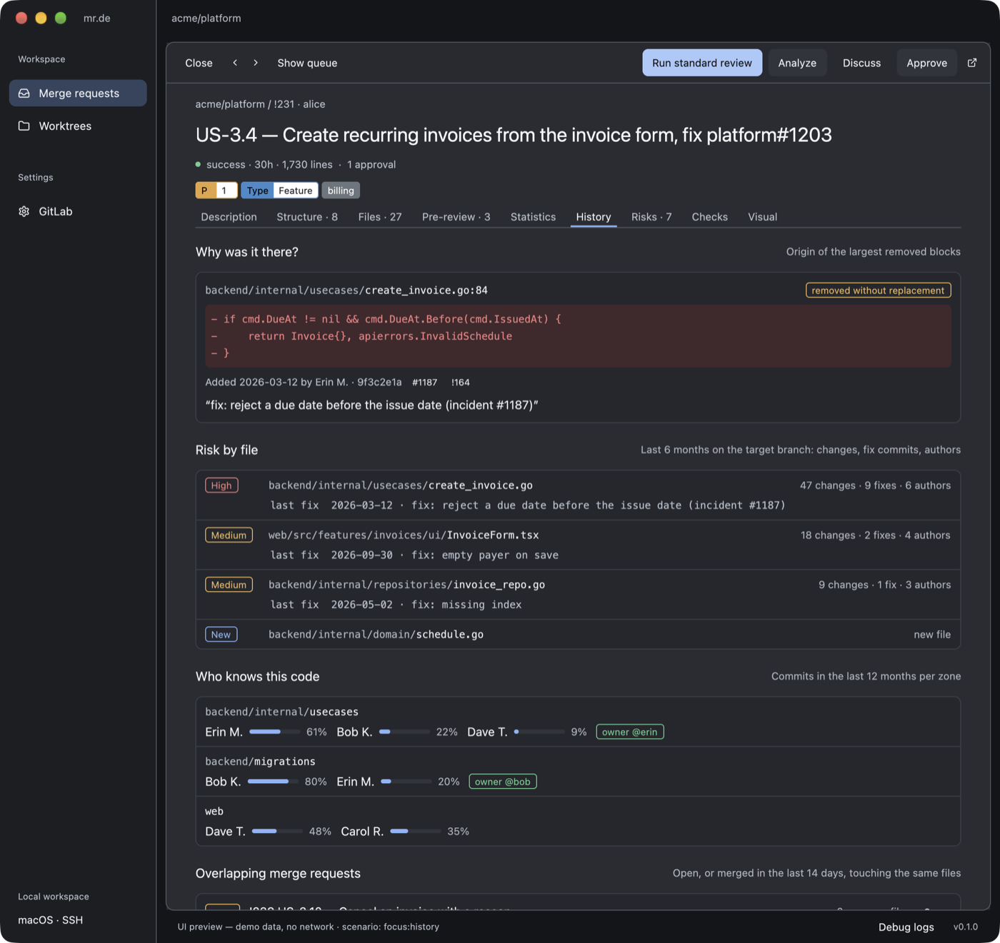

# User guide

- [Configuration](#configuration)
- [Review workflow](#review-workflow)
- [Queue, labels, and priority](#queue-labels-and-priority)
- [Reader](#reader)
- [Pre-review with Claude](#pre-review-with-claude)
- [Understanding complex merge requests](#understanding-complex-merge-requests)
- [Specification compliance](#specification-compliance)
- [Visual comparison](#visual-comparison)
- [Discuss](#discuss)
- [Approval](#approval)
- [Worktrees and cache](#worktrees-and-cache)
- [Debug logs](#debug-logs)

## Configuration

Open **Settings**, enter your GitLab base URL and personal access token, and optionally the
two Cloudflare Access service-token fields. **Test connection** validates authentication
without saving anything. **Save** persists the settings without any network request. Both
actions show their progress and result inline; secret inputs stay masked and are never
cleared. The token needs API access to read merge requests and issues and to approve, which
is typically the `api` scope. SSH access for Git is independent of the token.

A blank secret field keeps the saved value for that instance. **Remove saved Cloudflare
credentials** clears the Cloudflare pair explicitly. Credentials are stored under the `mrde`
service in the macOS Keychain, never in TOML or SQLite.

Non-secret settings live in `~/.config/mrde/config.toml`:

```toml
gitlab_url = "https://gitlab.example.com"
refresh_seconds = 120
claude_path = "claude"
mr_roles = ["reviewer", "assignee"]   # any of "reviewer", "assignee", "author"
mr_sort = "priority"                  # "priority", "newest", "oldest", or "smallest"
spec_path = "~/code/my-project/specs" # optional, used by Check compliance
visual_command = "pnpm --dir web exec playwright test visual"  # optional
```

- `claude_path` may be an absolute path.
- `refresh_seconds` is clamped to at least 30 seconds. The periodic refresh pauses while
  another operation runs, in Settings, or while an approval confirmation is open.
- The toolbar above the queue edits `mr_roles` and `mr_sort`; these preferences save
  immediately, without touching credentials. At least one role stays selected.
- **Specification folder** sets `spec_path`. `~` is expanded and the folder must exist when
  saving. Leave it empty to disable the compliance check.
- **Screenshot command** sets `visual_command`; see [Visual comparison](#visual-comparison).

Restart the application after editing the file by hand.

## Review workflow

1. Connect GitLab. The queue refreshes at startup and periodically; cached merge requests
   stay visible meanwhile, and navigation is never blocked by a refresh.
2. Select a merge request to read its description, linked issues, and changed files.
3. Choose a depth in **Pre-review** and click **Run review**.
4. For a large merge request, click **Analyze**, then **Generate tour** in **Structure**,
   and read **History** and **Risks**. For interface changes, click **Capture screenshots**
   in **Visual**.
5. Click **Check compliance** in **Checks** to compare the ticket and the change with your
   specification.
6. Click **Discuss** to continue in a terminal with Claude Code and the prepared context.
7. Click **Approve**, check the merge request and commit in the confirmation, then confirm.

## Queue, labels, and priority

The queue lists open, non-draft merge requests where you hold one of the selected roles,
deduplicated across roles and projects. Each row shows the project, author, title, labels,
pipeline, age, diff size, and approval count. The queue shows 25 merge requests per page;
sorting applies to the whole queue before pagination.

Sorting options:

- **Priority** (default): numeric priority labels first (`P0` before `P1`; both `P0` and
  `P::0` are recognized), then pipeline readiness, age capped at 30 days, then smaller diffs.
  Other labels have no effect on ranking.
- **Newest**, **Oldest**, or **Smallest diff** (unknown sizes last).

A merge request shows its own labels followed by those of the ticket it implements, because
many teams label tickets rather than merge requests. The ticket is the related issue
referenced in the merge request title (for example `fix web-app#3436`), else in its
description, else the only related issue. Issues merely mentioned elsewhere are ignored, so
their statuses and priorities do not leak in. Both `/-/issues/` and `/-/work_items/` links
are recognized. Priority sorting uses merge request and ticket labels.

Queue rows show one line of labels, priority first, then `+N`; the reader lists all of them.
Label colors come from GitLab. The merge request list returns them directly; the single-MR
and related-issue endpoints return names only, so mr.de colors them from the project's labels
(including parent groups), cached for ten minutes per project. A scoped label such as
`Review::Dev` shows two adjoining segments: the scope in the label color, the value on white.

## Reader

Selecting a merge request shrinks the queue and opens the reader below it. **Focus** hides
the queue and **Show queue** restores it; the arrows move to the previous or next merge
request across pages; **Close** returns to the full queue. The reader has these tabs:
Description, Structure, Files, Pre-review, Statistics, History, Risks, Checks, and Visual.
After an analysis, tab labels show counts; hover them for details.

Descriptions, issues, and Claude's prose render Markdown: headings, emphasis, links, lists,
task lists, tables, quotes, code blocks, and Mermaid diagrams (top-level ```` ```mermaid ````
blocks, rendered without a browser).

Images resolve relative to the document's project. GitLab uploads such as
`/uploads/<secret>/image.png` are downloaded through the authenticated uploads API (GitLab
17.4 or later), including Cloudflare headers; public HTTP images load without credentials.
Downloads run in the background, four at a time, up to 10 MiB each. Clicking an image opens
a viewer that fits the window; **Escape** returns to the same position.

**Statistics** shows the *Disktree*, a treemap of changed lines per file grouped into zones
(directories). It is estimated from GitLab diffs at once; **Compute statistics** replaces the
estimate with exact `git diff --numstat` counts from the merge request worktree. After an
analysis, the Disktree can be colored by file risk instead of zone.



## Pre-review with Claude

Choose **Quick**, **Standard**, or **Deep**, then click **Run review**. mr.de verifies the
source and base commits, creates or reuses a detached worktree, and runs Claude only when no
cached result exists for that commit and depth. The result shows a summary, the intention,
risks ranked by severity, files to read first, and a confidence level. Selecting a merge
request shows the most thorough cached review for its commit.

The command is `claude -p <fixed instructions> --output-format json` with the read-only
`Read`, `Glob`, and `Grep` tools. The merge request context, including diffs against the
base commit, is sent on standard input and never in process arguments. Budgets per depth:

| Depth | Per file | Total | Timeout |
|---|---|---|---|
| Quick | 8,000 characters | 60,000 | 5 minutes |
| Standard | 20,000 | 200,000 | 10 minutes |
| Deep | 40,000 | 400,000 | 20 minutes |

Truncated diffs are marked so Claude reads those files in the worktree. Malformed output,
CLI errors, and invalid confidence values are rejected. Claude is told not to claim that
tests ran. A worktree with local changes cannot produce a fresh analysis.

## Understanding complex merge requests

**Analyze** (toolbar, or the button shown in an analysis tab) reads the merge request
worktree with read-only Git commands, without Claude, and fills three tabs. Only the search
for overlapping merge requests contacts GitLab.

### Structure


- **Guided tour** (Claude, on click): the change grouped into three to seven reading steps,
  the core step highlighted, files you can skip, and the main flow as a Mermaid diagram.
- **Changed symbols**: functions, methods, types, and classes added, removed, modified, or
  with a changed signature (shown before and after), for Go, TypeScript and JavaScript,
  Rust, and Python.
- **Impact**: callers of modified, removed, or re-signed definitions at the merge request
  commit, flagging those the merge request did not touch.
- **File graph**: imports between changed files, plus HTTP calls from client code to
  endpoints declared by the merge request.

### History



- **Why was it there?**: for the largest removed blocks, the commit, author, and `#issue` or
  `!merge request` references that introduced them (`git blame` on the base commit).
- **Risk by file**: six months of target-branch history (changes, fix commits, authors).
- **Who knows this code**: top authors per changed area over twelve months, plus
  `CODEOWNERS` owners.
- **Overlapping merge requests**: open, or merged in the last 14 days, touching the same
  files. A merge request merged after this one started may require a rebase.

### Risks

- **Contracts**: database migrations (`NOT NULL` without default, renames, drops,
  non-concurrent indexes, missing down scripts), added and removed HTTP endpoints, OpenAPI,
  GraphQL, and Protobuf removals, environment variables missing from env samples, and
  permission strings.
- **Dependencies**: direct dependency changes in `go.mod`, `package.json`, `Cargo.toml`, and
  `requirements.txt`, with major upgrades flagged, and lockfile counts.
- **Risky patterns** in added lines only: queries or `await` in loops, ignored Go errors,
  empty catch blocks, `useEffect` without dependencies, hardcoded secrets, `unwrap`, `eval`,
  raw HTML, debug output, and more.

Analysis results are cached per commit and restored when the merge request is selected
again; they are never shown for another commit.

## Specification compliance

Set a **Specification folder** in Settings, then click **Check compliance** in **Checks**.
Claude reads the folder (Markdown, Gherkin, or YAML), finds the documents covering the
ticket, and reports a verdict and a traceability matrix: for each requirement or Gherkin
scenario, the specification file, the implementing code (`path:line`), the tests, and a
status (met, partial, missing, unclear). Requirements met without a test are flagged.


## Visual comparison

Set a **Screenshot command** in Settings. **Capture screenshots** in **Visual** runs it with
`/bin/sh -c` in a worktree of the base commit and one of the merge request commit (created
if missing). Each run gets `MRDE_SCREENSHOTS_DIR`, an empty output folder, and `MRDE_SIDE`,
`before` or `after`. The command must write PNG files there (subfolders allowed) within 20
minutes. Files with the same relative name are compared pixel by pixel; channel differences
up to 16 count as unchanged. Each screen shows before, after, and a difference image.

The command comes only from your configuration, never from the repository, and runs only
when you click. mr.de does not start servers or seed data: your command must do it.

## Discuss

**Discuss** writes the merge request context (description, issues, existing pre-review) to
`~/Library/Caches/mrde/context/`, outside the worktree, then opens Ghostty in the worktree
with `claude --add-dir <context dir>` and a fixed first message. Only fixed text and
application-built paths reach the command line, so merge request text is never interpreted
by a shell.

## Approval

**Approve** opens a confirmation showing the merge request and the commit SHA. Confirming
sends the approval bound to that SHA; GitLab rejects it if the merge request changed in the
meantime. mr.de never merges. Approval availability depends on your GitLab edition and
project permissions.

## Worktrees and cache

- Cache and history: `~/Library/Caches/mrde/mrde.sqlite3`.
- Bare repositories and detached worktrees: `~/Library/Caches/mrde/git/<instance hash>/`,
  one worktree per merge request commit.
- Screenshots: `~/Library/Caches/mrde/visual/`.

The **Worktrees** page lists mr.de worktrees with their local-change state. **Clean** removes
one worktree and refuses if it contains local changes or ignored files; bare repositories
remain. Close any terminal session using a worktree before cleaning it. Listing and cleaning
worktrees and computing statistics do not contact GitLab.

## Debug logs

**Debug logs** in the footer toggles a bounded, timestamped panel with connection and save
stages and the start and result of every action. Errors from actions you start open it
automatically; periodic refresh errors stay in the status line. HTTP bodies and
authentication headers are never logged, and secrets are redacted from error text. Logs are
kept in memory only. Set `RUST_LOG=mrde=debug` for more detail on standard error.
